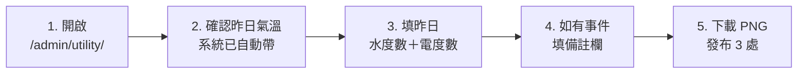
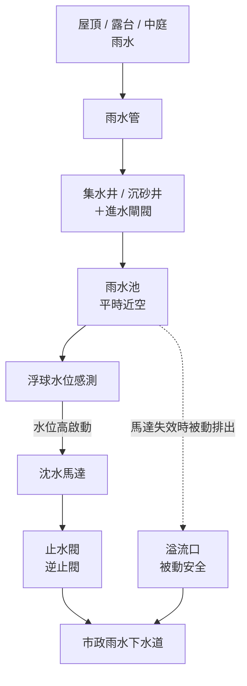
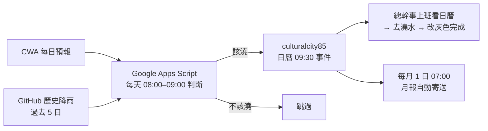
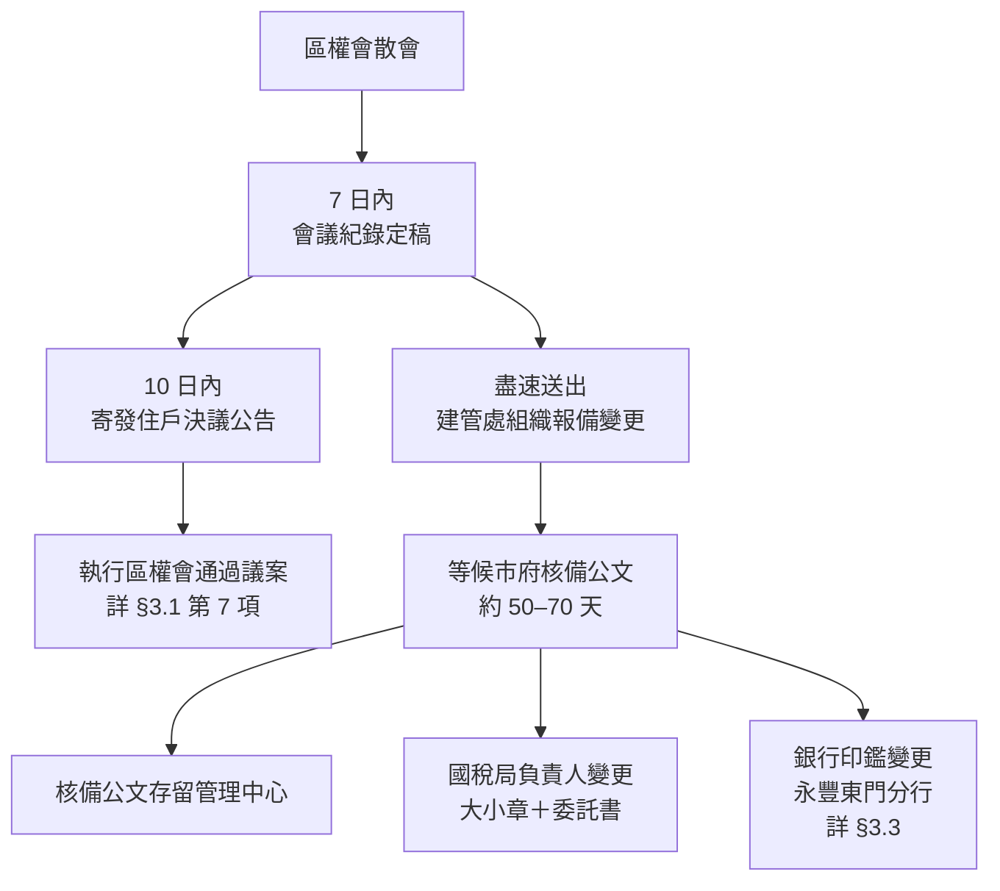

# 前言

歡迎您進駐閱大安社區擔任總幹事。本份 Wiki 整理了社區的數位系統、日常例行、設施保養、廠商合約、財務、行政、安全防災與住戶關係等各面向的工作內容與標準作業流程，作為您到職訓練、日常工作與未來交接時的依據。

社區自第一屆管委會以來追求「**屬社區的資產而非屬個人的習慣**」——也就是不論誰擔任總幹事，社區的管理品質應該維持穩定、文件格式應該一致、廠商關係與住戶資料應該完整保存。第一屆任期內曾經歷四位總幹事、四種公告格式、四種財報格式、四種會議記錄格式，每次換人就重來一次，經驗也跟著流失。本份 Wiki 就是為了讓下一位總幹事不必從零開始，也希望您在工作中持續累積、優化內容。

**請先沿用社區既有的作法。**公告、財報、會議紀錄的格式，以及本 Wiki 寫下的流程與工具，都是歷屆管委會逐步定下來的，請照著做，不要依個人習慣另起一套。若您覺得有更好的作法，非常歡迎提出——請先與主委討論，經同意後再調整，並把新作法更新到本 Wiki，讓下一任也能接續。

## 怎麼使用這份 Wiki

- **剛到職**：先讀下一章「到職導讀」列出的幾節，其他章節不必從頭讀完。
- **日常工作**：遇到某件事時，從左側目錄找到對應章節查作法。每一節只寫現行作法與必要的原因。
- **想知道當初為什麼這樣決定**：請查 Notion「議題事項追蹤」（第七章 §1.2），歷次討論與決議都在那裡。
- 作法有變動時，該節會整節改寫成最新版本；舊版本由網站的版本紀錄保存。


---

# 到職導讀

到職第一個月，建議依下列順序閱讀。其餘章節遇到再查即可。

**第一週**

- 第一章：角色與原則
- 第二章 §1「核心數位身份與帳號管理」、§2「Google Workspace 雲端辦公室規範」（尤其 §2.3 日曆）
- 第三章 §1「每日水電公告產生器」——每天上午的例行工作
- 第八章 §1「安全防災」——火災、地震、停電、颱風發生時怎麼做
- 第九章 §1.0「對住戶的溝通語氣原則」

**第一個月**

- 第五章 §1「年度循環行事曆」——之後每月初看一次，確認當月要啟動的事
- 第六章 §2「財務流程」——零用金與財務報表
- 第七章 §1「會議與議題管理」

## 查詢索引：答案在哪裡

規約、辦法、名冊、廠商資料各有正本，本 Wiki 不重抄，只告訴您去哪裡查。辦法以網站版為準。

| 想知道 | 正本在哪裡 |
|---|---|
| 花多少錢要誰核准、採購要不要比價 | [《財務管理辦法》](/regulations/regulations-財務管理辦法.html)第六條（核准權限）、第十六條（比價）；實務流程見第一章 §3.3 |
| 管理費繳費期限、催繳、欠費公告與法律催討 | [《管理費收繳辦法》](/regulations/regulations-管理費收繳辦法.html)第四、六條；[社區規約](/regulations/regulations-社區規約.html)第十七條 |
| 磁扣增購與遺失註銷、包裹代收、訪客、仲介與鎖匠進出、搬家報備 | [《門禁管理辦法》](/regulations/regulations-門禁管理辦法.html) |
| 公設登記、包場收費、健身房開放時間 | [《特定公共空間管理辦法》](/regulations/regulations-特定公共空間管理辦法.html) |
| 汽機車位、臨時停車、搬家車輛 | [《停車空間管理辦法》](/regulations/regulations-停車空間管理辦法.html)；實務補充見第九章 §7 |
| 機車位契約、名冊、收據 | Google One `03. 住戶管理\04. 停車位管理\02. 機車停車位\` |
| 室內裝修申請與保證金 | [《裝潢修繕施工管理辦法》](/regulations/regulations-裝潢修繕施工管理辦法.html)；作業流程見第九章 §5 |
| 寵物、垃圾分類 | [《飼養動物管理辦法》](/regulations/regulations-飼養動物管理辦法.html)、[《垃圾分類回收指引》](/regulations/regulations-垃圾分類回收指引.html) |
| 委員是誰、各自職權 | 名冊：Google One `01. 行政管理\03. 管理委員會\閱大安歷屆管理委員會成員.xlsx`；職權：[社區規約](/regulations/regulations-社區規約.html)第十三條 |
| 廠商、合約期間、聯絡人 | Notion 社區資料中心「廠商名錄」「合約」「廠商聯絡人名冊」 |
| 區權人與承租人名冊 | Notion「區權人與使用者」（第九章 §1.4） |
| 進行中的議題與歷次決議 | Notion「議題事項追蹤」（第七章 §1.2） |
| 每月、每年要做的事 | 第五章 §1 年度循環行事曆；物業自用的「年度案場工作計畫表」在 Google One `07. 物業管理\` |
| 保全、清潔的每日工作 | Google One `07. 物業管理\現場人員資料\案場物管人員工作及注意事項.xlsx`；清潔頻率表在 `07. 物業管理\清潔業務\` |
| 重要設備與鑰匙在哪裡 | 第四章 §7；鑰匙清冊在 Notion「財產清冊」 |
| 空白表單（訪客 eTag 開通、公設登記、物品借用） | Google One `01. 行政管理\表格、其他、告示\各項表格\` |
| 對講機號碼 | Google One `01. 行政管理\對講機按碼.xlsx` |
| 竣工圖 | 紙本在 2F 儲藏室文件櫃；電子檔在 Google One `05. 維修與設備\` |


---

# 第一章：角色與原則

## 1. 目標與願景

本份 Wiki的編撰並非僅為了規範行政細節，而是為了達成以下戰略目標：

- **願景**：實現社區管理的連續性與一致性，不因人員更迭而中斷。
- **核心轉變**：將管理知識從依賴個人的「屬人」性質，轉變為歸屬於社區的「屬社區」資產。
- **終極目的**：保護並累積閱大安社區的「無形資產」（如：管理經驗、廠商關係、決策脈絡）。

## 2. 核心策略與指導原則

為了落實上述願景，總幹事在執行日常勤務時，應遵循以下四大指導原則：

### 2.1 數位化優先

社區自第一屆管委會起便確立「無紙化辦公」的傳統。總幹事應熟練運用雲端協作工具（如 Google Workspace, Notion），擺脫傳統紙本作業模式，確保資料能即時同步與備份。

### 2.2 成本效益意識

總幹事應具備主動為社區「省錢」與「創造價值」的意識。

- 善用電商平台進行比價與採購。
- 為社區尋求最具經濟效益的解決方案，而非僅依賴廠商報價。

### 2.3 視覺形象一致性

為維護社區整體的專業形象與品牌質感，**嚴禁使用任何自製、非官方設計的標語或公告**（如手寫、Word 簡易排版）。

- 社區已建立一套完整的視覺識別系統（VIS）。
- **執行要點**：例行保養公告由「閱大安-維養」日曆產生，其他公告由主委或委員依視覺識別範本設計（見第七章 §2.1）；總幹事不自行用手寫或 Word 排版製作公告。

### 2.4 自立自強原則

無論進駐的物業管理公司品牌為何，社區的實際管理品質，最終取決於「管委會的投入」與「駐點總幹事的專業責任心」。物業公司的標準流程是基礎，閱大安在此之上有自己的作法，記錄在本 Wiki。

## 3. 角色定位與職責界定

### 3.1 角色分工

- **管理委員會**：制度建立者（制定遊戲規則與決策）。
- **物業公司/總幹事**：專業執行者（落實決策並提供專業建議）。

### 3.2 總幹事職責界定

為了讓總幹事能專注於高價值的管理工作，我們明確區分核心與非核心職責：

- **核心職責**：
    - 專業管理顧問。
    - 廠商協調與談判。
    - 行政與財務作業。
    - 數位系統操作與維護。
    - 確實執行管委會決議。
- **非核心職責（釐清期待）**：
    - **範疇**：如更換燈管、簡易修繕等勞務工作。
    - **原則**：此類工作屬於總幹事在**「不影響核心勤務」且「確保自身安全」前提下**，願意提供的額外協助，**但不應被視為理所當然的份內之事**。責任劃分需清晰，避免因瑣事癱瘓核心管理機能。

### 3.3 花錢與決策的流程

- **核准權限**：依[《財務管理辦法》](/regulations/regulations-財務管理辦法.html)第六條，總幹事、主委、管委會、區權會各有可核准的金額上限；單次採購達一定金額要三家比價（第十六條）。動支前先對照條文，超過自己權限的一律先問主委。
- **急事先決、事後追認**：等不到下次開會的事項（例如 2026-10 發電機電瓶老化），由主委在委員 LINE 群組徵詢，委員過半數同意後回簽報價，下次管委會再提請追認。
- **委員不單獨議價**：委員未經管委會授權，不與廠商單獨洽談議價（同辦法第十八條）；廠商報價、議價由總幹事窗口進行，管委會審議。

## 4. 具體執行辦法

為落實管理哲學，我們將透過以下具體手段執行：

1. **文件標準化**：統一所有公告、財報、會議記錄的格式。
2. **流程制度化**：將複雜的任務拆解為標準作業程序。
3. **建立社區知識庫**：利用 Notion 建構可搜尋、可積累的知識中心。
4. **管委會主導的職前訓練**：由管委會親自對新任總幹事進行導讀與訓練，讓新任總幹事儘快熟悉社區既有作法。


---

# 第二章：工具與帳號

## 1. 核心數位身份與帳號管理

閱大安社區的數位運作核心建立在統一的公務身份上，總幹事需妥善保管以下核心資產：

### 1.1 公務手機門號

- **號碼**：`0989-648-285`
- **合約與電信商變更紀錄**：
    - 原為遠傳電信（499元限速 21Mbps 吃到飽），合約於 2025/08/30 到期。
    - **現況**：已於 **2025/10/03 凌晨起** 攜碼轉移至 **中華電信**（合約維持499元限速 21Mbps 吃到飽）。
    - **目的**：方便將行動電話帳單與社區市話帳單整合為同一份電子帳單，簡化請款流程。

### 1.2 公務 Google 帳號

- **帳號**：`culturalcity85@gmail.com`
- **重要性**：此帳號為社區數位資產的「鑰匙」，綁定了所有雲端檔案、照片、聯絡人與第三方服務。

### 1.3 密碼存放與交接

- **存放原則**：嚴禁寫在便利貼或私下記錄。
- **指定路徑**：所有社區相關系統（含 Wi-Fi、廠商後台、公務帳號）的最新密碼，統一存放於 Google Drive：
    - 路徑：`\01. 行政管理\11. 帳號密碼\社區各項密碼.xlsx`

### 1.4 帳號安全政策

遇下列時機，**必須強制變更** Google 及網銀等重要帳號之密碼：

1. **總幹事交接後**（新任到職日當天）。
2. **管理委員會換屆交接後**。

## 2. Google Workspace 雲端辦公室規範

### 2.1 Gmail（對外溝通樞紐）

- **日常維護**：作為與外部廠商的主要聯絡管道，總幹事應每日巡查。
- **信件管理**：
    - 定期刪除不必要的登入通知與廣告信。
    - 善用「標籤（Label）」與「資料夾」功能，將重要合約、報價單歸檔。
    - 保持收件匣整潔，避免重要訊息被淹沒。

### 2.2 Google 聯絡人（動態名冊）

- **維護職責**：社區於 2024 年間已建立基礎聯絡人資料，總幹事需根據住戶異動（買賣/租賃）及廠商更替情形，即時更新通訊錄。
- **進階資料庫（Notion）**：
    - 自 2025 年 6 月起，更完整且具備交互參照功能的「住戶名冊」與「廠商名冊」已建立於 **Notion 社區資料中心**。
    - **操作原則**：日常快速查找可用 Google 聯絡人，但**正式資料維護請以 Notion 為主**。

### 2.3 Google 日曆（排程管理中心）

所有社區時程務必數位化，嚴禁只寫在紙本桌曆上：

- **會議排程**：管委會例會固定於 **每月第二個星期一 20:00**。
- **維護排程**：每月初需主動向廠商（機電、電梯、園藝、水塔、消毒、高壓清洗、修繕等）確認當月保養日期，登錄至「**閱大安-維養**」日曆。**這本日曆就是住戶公告的唯一來源**：主委每月據此產出網站上的「公共設施保養維修時程」，不需另做 Word 公告。因此每筆事件請照以下格式：
    - **標題**：`項目（廠商）`，例如「園藝保養（綠石文化）」「清洗水塔（潤泰公寓大廈維護保養）」。
    - **時間**：填實際的起訖時間，**不要設成「全天」**（住戶要知道幾點到幾點）。
    - **說明欄**：寫住戶看的施作範圍，一行一項。說明欄留白的事件（例如場勘、報價）會被視為內部事項，不會出現在公告上。
    - **內部備註**（例如「同步邀請信盛會勘」）不要和施作範圍混在一起，請另起一段並註明「內部」。
    - 日期或時間異動時，**直接改日曆事件**，並告知主委更新公告。
- **清潔排程**：
    - 主要是因為清潔人力通常無法在一天當中將大樓進行完整的清潔，因此勢必要依照有限的人力進行排程，請總幹事針對清潔排程進行公告
    - 住戶通常會關心何時會輪到打掃自家門前走廊，特別是有他們發現有髒污時，若有住戶主動反映此類事件請總幹事指揮清潔人員或保全機動支援

**自動提醒（系統建立，不用手動設定）**：社區有一組後台程式（在 culturalcity85 帳號的 Google Apps Script 執行），會依氣象署、市府等公開資料，自動在 culturalcity85 日曆建立事件，或寄信到 culturalcity85 信箱。請依**標題開頭的 emoji** 判斷類型、對應 SOP：

| Emoji 前綴 | 出現在哪 | 什麼時候出現 | 要做什麼 |
|---|---|---|---|
| 💧 今日建議澆水 | 日曆（當天 09:30） | 連日少雨或高溫無雨 | 澆水後把事件改成灰色（第六章 §3.2） |
| ⚠️ 臺北X燈 | 日曆（當天全天） | 氣象署高溫資訊把臺北列入黃／橙／紅燈 | 貼高溫圖卡、關心獨居長輩（第八章 §2.4） |
| ❄️ 臺北X燈 | 日曆（當天全天） | 氣象署低溫資訊把臺北列入燈號 | 貼低溫圖卡、關心獨居長輩，比照高溫做法 |
| 🌧️ 臺北豪雨／大雨・防汛準備 | 日曆（全天） | 氣象署對臺北發布豪雨或大雨特報 | 巡排水溝、確認防水閘門可隨時安裝（第八章 §1.2） |
| 🌧️ 強降雨即時警報 | 信箱 | 大安森林測站 10 分鐘雨量超過門檻 | 注意地下室車道與排水，以現場雨勢為準 |
| 🌬️ 強風即時警報／強風預報提醒 | 信箱 | 實測陣風或未來 36 小時預報達門檻 | 把電動大門改為手動（第八章 §2.1） |
| 🌀 颱風陸上警報 | 日曆 | 陸上颱風警報涵蓋臺北市 | 防颱準備（第八章 §1.2） |
| 🔍 颱風後巡查 | 日曆 | 陸上颱風警報解除後隔日 | 災後巡查（第八章 §1.2.2） |
| 🚧 路權施工 | 日曆＋信箱（每天 07:00 檢查） | 市府「申請使用道路」系統出現社區周邊巷道的施工申請 | 留意施工期間的車道進出與噪音；需要時向住戶公告。網站只公開地址、時段與狀態，施工單位要問現場或轄區分局交通組 |
| 📢 停水提醒 | 日曆 | 主委於全戶停水前建立（前一晚、當天早上各一） | 第四章 §1.5 三段提醒 |

- **帳單自動存檔**：台電、自來水、中華電信寄到 culturalcity85 信箱的電子帳單與繳費憑證，程式每小時會自動解密、改名，存進 Google One `06. 社區廠商\01. 公共事業\` 各公司的資料夾，並在信件加上「帳單已歸檔」標籤。這些信不用手動下載，也請不要刪除或移除標籤。若看到信件被標上「帳單需檢視」，代表自動存檔失敗，請告知主委。
- **該出現卻沒出現**（例如氣象署已發高溫燈號，日曆卻沒有事件）：先照該 SOP 手動處理，再把狀況告訴主委，由主委檢查程式。
- 程式本身由主委維護，總幹事不需要登入 Apps Script 或修改任何設定。

### 2.4 Google Tasks（任務指派）

- 此為**主任委員與總幹事之間**的主要溝通介面。
- 日常待辦事項、臨時交辦任務，均透過此工具進行指派與追蹤，避免 Line 訊息洗版而被遺忘。

### 2.5 Google Photos（影像資產庫）

- **集中管理原則**：
    - 本社區的相關照片/影片請盡量用已經設定好社區Google帳號的手機進行拍攝，並注意是否已經順利上傳至Google Photos的空間
    - 若您私人手機的畫質較社區手機佳，或手邊剛好只有私人手機，也歡迎直接使用私人手機拍攝，但請記得最後還是將相片**手動上傳**至Google Photos
- **禁用平台**：
    - ❌ **Line 相簿**：檔案會過期，畫質會被壓縮，且不易搜尋。
    - ❌ **YouTube**：社區雖然也可上傳影片至Youtube且較不佔空間，但考慮相片與影片的集中度與便利性等問題，請仍然以Google Photos為唯一的上傳平台，不另行上傳 YouTube。
- **拍攝指引（短影片優先）**：
    - **以短影片為主，靜態相片為輔**：對於漏水、設備異音等動態問題，影片能提供比照片更豐富的資訊。
    - **附帶旁白**：拍攝時應有意識地運用廣角、特寫、多視角取景，並搭配口頭說明，讓平日比較沒有接觸到社區細節的住戶或管委能夠較完整的瞭解問題全貌

### 2.6 Google Drive（雲端檔案總管）

- **工作模式變革（重要）**：
    - ❌ **錯誤做法**：在電腦桌面編輯 Word/Excel 檔 -> 做完再上傳（容易造成版本混亂、漏上傳）。
    - ✅ **正確做法**：**直接在 Google Drive 資料夾中開啟檔案進行編輯**。Google 具備即時儲存與版本紀錄功能，確保資料永遠同步。
- **容量說明**：本社區 Google One 方案已於 2025 年 7 月擴容至 **200GB**，請安心存放文件與影像。

## 3. Line 官方與群組管理

### 3.1 群組分類與功能

社區 Line 群組區分為不同層級，總幹事需嚴格遵守發言界線：

1. **社區公告群組**：僅限管理中心發布重要公告（單向），避免社區公告被住戶的討論淹沒。
2. **住戶討論群組**：住戶交流區，總幹事需適度關注但不介入非公務閒聊。
3. **管理委員會群組**：核心決策圈。
4. **管委會+建設公司群組**：涉及保固修繕議題使用。

### 3.2 權限交接

- 總幹事異動時，務必確認所有群組的管理權限已完整移轉給新任總幹事或主委。

## 4. Notion 社區資料中心

- **啟用時間**：2025 年 6 月建置。
- **核心價值**：
    - 解決傳統 Office 檔案分散、難以交互參照的問題。
    - 包含 **12 個模組、32 張資料表**（如：住戶資料可直接連動管理費紀錄、廠商資料可連動維修紀錄）。
- **操作與學習門檻**：
    - 此系統功能強大，但對於習慣傳統文書作業的總幹事可能會有**轉換陣痛期**。
    - **心態建設**：初期操作較慢是正常的，請務必參閱專屬教學章節，一旦上手，將大幅減少重複作業的時間。

## 5. 智生活（社區管理APP）管理後台

### 5.1 核心功能操作

- **管理費收繳**：每月 **20 號** 為系統關帳日，需登入後台進行結算與報表產出。
- **包裹通知**：確實登錄，系統將自動推播給住戶。
- **瓦斯度數回報**：提醒住戶透過 App 回報度數。

### 5.2 公告發布

- 智生活 App 為社區「公告張貼三處」之二（另外兩處為 Line 公告群組、信箱區螢幕）。

## 6. 其他數位設備與規範

### 6.1 信箱區液晶螢幕

- **用途**：電子佈告欄（公告張貼三處之三）。
- **內容**：需與 Line、智生活公告同步更新。

### 6.2 文件掃描標準

- 使用 Canon 事務機掃描多頁合約或文件時，務必設定存為 **PDF 格式**。
- **嚴禁**存成多張 JPG 圖片檔，以利後續歸檔與閱讀。

### 6.3 網路環境（Wi-Fi）

- **服務商**：
    - **凱擘大寬頻**：提供 1F 大廳、2F 公共空間。
    - **今網寬頻**：提供 RF 頂樓、地下室公共空間。
- **歷史決策脈絡（為何不選中嘉？）**：
    - 第一屆管委會曾評估導入「中嘉寬頻」，但因**管道數量**與**機電箱空間限制**，最終決定不導入。
    - **提醒**：未來若有網路升級需求，請優先考量現有兩家廠商，避免重複評估不可行的方案。
- **密碼管理**：全社區公共區域 Wi-Fi 密碼皆已統一（請洽弱電廠商或查閱密碼表）。

### 6.4 大廳多功能事務機

- **列印原則**：以灰階為主，特殊情形才印彩色；文件以數位檔保存，減少不必要的紙本（稽核可看電子檔；參加公寓大廈評比才需要紙本）。
- **住戶使用**：開放住戶影印、掃描，收費比照超商（2023/08 參考價：A4 黑白 3 元、彩色 10 元），超商調價時跟著調。管委會開收據，記入影印掃描帳本，列為管理費的其他收入。

### 6.5 AI 工具應用

- 鼓勵總幹事使用 **ChatGPT** 或 **Gemini** 等生成式 AI 工具，協助草擬公告文案、信件回覆或活動企劃，提升行政效率。


---

# 第三章：日常例行

## 1. 每日水電公告產生器（每日例行工作）

每天早上完成「每日水電公告」是總幹事的核心例行工作之一。位於 `/admin/utility/`，**用社區公務帳號的密碼即可登入**。

這個工具會：
- 自動帶昨日臺北氣溫（GitHub Actions 凌晨自動抓取 CODiS 資料）
- 根據昨日最高溫推算「**目標用電量**」並標示狀態（低於 / 接近 / 超出預期）
- 根據是否清潔日，套用兩段式用水標準（清潔日 ≤0.5 度為正常、非清潔日 ≤0.2 度為正常）
- 一鍵產生公告卡片 PNG，可直接下載發布

### 1.1 每日工作流（5 步驟）



**詳細步驟**：

| # | 動作 | 時點 | 來源 |
|---|---|---|---|
| 1 | 開啟 `/admin/utility/` | 每天早上 09:00 前 | 瀏覽器書籤 |
| 2 | 確認昨日氣溫（系統已自動帶）| — | CODiS 466920 臺北站 |
| 3 | 填昨日**水度數**（單日 + 累計）| — | 台北自來水「水管家」系統 |
| 3 | 填昨日**電度數**（單日 + 累計）| — | 「臺灣電力 APP」AMI 智慧電錶 |
| 4 | 填備註（如有事件）| — | 見 §1.3 |
| 5 | 下載 PNG → 發布 3 處 | 09:00 前 | 見 §1.2 |

### 1.2 三個發布管道（同步）

公告 PNG 必須同步發布在以下三處——這是「公告張貼三處」的標準作業（呼應第二章 §3.1、第二章 §5.2、第二章 §6.1）：

| 管道 | 操作 | 受眾 |
|---|---|---|
| **Line 公告群組** | 在「閱大安社區公告群組」貼上 PNG | 全體住戶（即時推播） |
| **智生活 App 公告** | 後台上傳 PNG | 全體住戶（App 推播） |
| **信箱區液晶螢幕** | 透過後台更新顯示圖檔 | 進出大樓住戶（被動看到） |

### 1.3 備註欄使用原則（重要）

備註欄不是裝飾——是**社區用水/用電歷史資料庫的關鍵欄位**，每筆事件都會成為未來判斷異常的依據。請務必當天填寫，事後補登記憶會模糊。

**該填的事件類型**：

- **設備異常或故障**：揚水馬達、抽水泵、空壓機、冷氣等運作異常
- **設備維修或更換**：哪天請哪家廠商來修什麼
- **計水/計電中斷**：智慧電錶或水管家系統當機、抄表延遲
- **特殊用水/用電場景**：水塔清洗、外牆清洗、高壓沖洗、大型活動
- **施工**：住戶裝修、社區工程、廠商進場
- **異常天氣**：颱風前後、寒流、熱浪

**為什麼這件事重要**：2026 年 4 月曾發生揚水馬達軟管破裂、3 天用電飆到 540 度（vs 平日 200 度）。**因為當時備註欄有記**，事後查資料時才能快速判斷「這 3 天是設備故障、不是熱浪」，避免污染整個迴歸模型。詳見第六章 §3.1.3。

### 1.4 故障排除

| 症狀 | 處理 |
|---|---|
| 開頁面跳「需要登入」 | 用社區公務帳號密碼登入；密碼存於 Google Drive `\01. 行政管理\11. 帳號密碼\社區各項密碼.xlsx` |
| 工具列顯示「離線模式」 | 雲端同步失敗，工具會暫存在這台電腦的瀏覽器；網路恢復後資料會自動同步上去 |
| 昨日氣溫沒帶 | GitHub Actions 偶爾延遲，可從 [CWA CODiS](https://codis.cwa.gov.tw/) 466920 臺北站手動查 |
| 電度數對不上 AMI | 台電 AMI 顯示有時延遲一天，以實際抄表日為準 |

### 1.5 為什麼這個工具的真正價值是「資料庫」

**短期看**：每天發 1 張公告而已。
**長期看**：4 年累積下來，是社區從未擁有過的真實水電歷史資料庫——

- 知道社區基準負載 ~190 度／日（不開冷氣最低耗電）
- 知道冷氣負載年化 ~18,500 度（19% 總用電）
- 知道公水自動澆灌排程過量 2-6 倍（vs 校準後的合理用量）
- 設備故障時可快速比對歷史用量曲線判斷原因

**這份資料庫就是您每天 10 分鐘工作的最大產出**。下任總幹事接手時，整套歷史可無縫延續判斷力。

## 2. 清潔

### 2.1 人力管理

- 清潔員每月休假 8 到 9 天（不含連續假期），**休假日不另補代班人力**（2024-11-08 第三屆第三次管委會）；先依排程確實完成工作項目，日後視需要再討論是否增加人力。
- 排休時避免連續兩天無人清潔；若影響清潔品質，請向管委會反映。

### 2.2 排程 SOP

- **緣由**：應對住戶對於「走廊為何多日未掃」的抱怨。
- **管理要求**：總幹事需維護詳細「清潔工作排程表」（範本與清潔工作頻率表在 Google One `07. 物業管理\清潔業務\`）。
- **溝通用途**：遇投訴時，出示排程告知預計打掃日期。

### 2.3 環境維護技巧

- **防狗尿**：可使用零用金購置「明星花露水」噴灑於騎樓柱邊驅趕犬隻。

## 3. 每月晚班

- 總幹事每月排 2 到 3 天晚班，時段 12:00–21:00（2026-10-12 第五屆第四次管委會同意）。
- 目的：了解夜班保全的工作需求，並在晚間處理清運公司不收的大型廢棄物。

## 4. 物業工作日誌

每天一張分頁，存於 Google One `07. 物業管理\工作日誌\{年}\{年月}\`。主委每天依工作日誌整理議題進度，所以下列欄位請寫到「別人看得懂、不必再問」的程度：

- **廠商進場**：哪家廠商、做什麼、結果（完成、待料、需報價）。
- **預計公告**：尚未發出但已知要發的公告。
- **住戶反映**：日期、戶號、事項，以及**處理經過與結果**；後續有進展就接著寫在同一筆，不另開新筆。
- **社區主任本日工作概要**：逐條列出，含當天管理費未繳戶數。

---

# 第四章：設施維護

## 1. 例行性保養排程與策略

### 1.1 機電保養

- **廠商**：太古華電
- **頻率**：依合約定期執行
- **年度換約啟動點**：合約到期前 2 個月由總幹事啟動議價，避免年底匆忙。詳見第五章 §2 廠商管理與招標。
- **延伸**：機電廠商有時會額外提報修繕／改善案（如緊急發電機保養、外掛式充電器增設），需由管委會單獨議決，不可預設併入年度合約。

### 1.2 電梯保養

- **廠商**：三菱電梯
- **合約期**：**兩年期**（與其他保養合約不同點）
- **現行合約**：2025-12-01～2027-11-30，每月 12,870 元（含稅），自 2023 年起未調漲。
- **續約條款**（合約第五條）：除非一方在合約屆滿前 2 個月以書面通知不續約，否則視為同意按原合約條件再續約，其後亦同。所以只有**要換廠商或不續約**時，才必須在到期年 9/30 前發出書面通知（現約到期 2027-11-30）；照原條件續約什麼都不用做。
- **換約時程**：過去兩次都在到期前一、兩個月處理（2023 年 10 月底報價、11/28 簽約；2025 年 12/1 起新約），跟其他合約一樣在年底議價即可。若三菱年底才提調價，三菱自己也沒在 9/30 前通知不續約，社區可依條款要求照原價續約。
- **議價原則**：
    - 廠商通常會嘗試小幅調漲（如 $12,870 → $13,100，漲 $230）
    - **管委會應堅持維持原價續約**，過往三菱多會接受
    - 議價策略：以「持續配合且無重大變動」為理由
- **法規衍生注意**：每三年公共安全檢查時，可能會有新的電梯相關法規要求（詳第五章 §4）

### 1.3 園藝

- **頻率**：原約每年 7 次（3、5、6、7、8、10、12 月），跳過冬季月份以節省預算。2026 年因植栽生長狀況不佳，加做 4 月與 9 月，全年共 9 次。1、2、11 月沒有園藝保養，月度公告掃不到園藝是正常的。
- **合約起算月**：原約自 12 月起算；換約後改成自 1 月起算，與曆年對齊。因此 2026 年 12 月要另補一次，新約自 2027 年 1 月開始。
- **年度換約啟動點**：合約到期前 2 個月由總幹事啟動議價。詳見第五章 §2。

### 1.4 電動大門

- **核心問題**：本社區電動大門因門扇重量（單扇約 190-200 公斤）對電動馬達造成較大負擔，使其成為最脆弱、最不耐久的一環，因此需要定期的專業保養。
- **市場特性**：自動門馬達（鉸鏈）在雙北市場基本上為「多堡科技」與「美德亞」兩家代理商所寡佔，導致議價空間極小。
- **保養廠商**：美德亞（早期為多堡）。
- **現行合約**：2026-07-31～2027-12-31，每季保養一次，每次兩台各 3,500 元（一年 28,000 元）；每季保養完成後當月月結匯款。
- **保養項目**：依 DORMA 原廠規定程序進行（檢視、清潔、防銹、潤滑、微調、校正、及教育住戶正確使用方式）。保養涉及專業系統檢查，無法由社區人員自行執行；總幹事安排時程並登錄到「閱大安-維養」日曆。
- **換門**：曾評估改為輕量化手動門或增設玻璃小門，未採行；任何換門決策都須經區權會同意。當時的報價與討論見 Notion 議題追蹤。

### 1.5 水塔清洗

- **技術特性**：頂樓為「單一進出水閥」相通設計，清洗時必定需要停水。
- **地下室水箱定水位閥**：
    - **故障訊號**：收到北水處「用水異常」通知時，先查定水位閥。
    - **B2 水箱**：2025-08-12 更換，由潤泰機電施作（25,200 元含稅，低於太古華電報價 31,500 元）。
    - **B4 水箱**：B3 進 B4 水量偏小，推測閥門生鏽開不全；報價約 5 萬元，暫緩。因 B2、B4 在社區成立三年多內陸續損壞，已請建設公司詢問原設計技師可否改用直動式浮球閥。
- **頂樓上水塔水位控制器（極棒）**：2025-07-16 因老化更換（太古華電，4,599 元），由機電保養時檢查。
- **最佳化時程 SOP（公告範本）**：
    - **事前宣導**：提醒儲水。**請 13-15 樓住戶 09:00 前關閉加壓馬達電源**，以免空轉燒毀。
    - **09:10-11:20**：放空頂樓上水塔（開始停水）。
    - **11:20-13:00**：清洗頂樓上水塔。
    - **13:00-15:00**：地下室打水至頂樓（逐漸復水），清洗地下室下水塔。
        - **復水提醒**：若無水請開水龍頭排氣。13-15 樓住戶記得重啟加壓馬達。
    - **15:00-17:00**：清洗地下室下水箱。
- **住戶提醒一定要做三段**：過去洗水塔當天常有住戶反映「沒有事前提醒」。原因是公告只在幾天前發一次，很快被群組訊息淹沒，而住戶真正要行動（儲水、關馬達）的時間是當天 09:00 以前。因此：

| 時機 | 管道 | 誰做 |
|---|---|---|
| ① 3–7 天前 | 網站公告＋LINE 社區公告群組＋智生活＋信箱區螢幕 | 主委產網站公告與 LINE 帶路圖，總幹事同步到智生活與螢幕 |
| ② **前一晚 20:00** | LINE 社區公告群組＋智生活推播；**對講機逐戶提醒 13–15 樓**關加壓馬達 | 總幹事 |
| ③ **當天 08:00** | LINE 社區公告群組＋智生活推播 | 總幹事（09:00 上班前，用手機發送） |

- ② ③ 會以「📢 停水提醒」事件出現在主日曆，事件內附可直接複製的文字，時間到照貼即可。
- 13–15 樓的對講機提醒最重要：忘了關加壓馬達會空轉燒毀，代價最高。
- 其他全戶停水、停電、電梯全停的作業，比照這三段辦理。

### 1.6 高壓沖洗

- **緣由**：曾有騎機車住戶因雨天地下室入口車道濕滑而摔倒。
- **解決方案**：評估後暫不採化學或物理防滑工程，維持每年兩次由物業公司執行高壓沖洗，已有效改善青苔問題。

### 1.7 公設空調保養清洗

- **執行策略**：安排於淡季（如 12 月），可與機電保養協調，利用搭設的鷹架一併處理大廳高處燈具更換。
- **高處燈具更換原則**：
    - **成本策略**：採「集中處理」或「一次性全數更換」，換下良品做備品，避免頻繁搭架。
    - **安全責任**：嚴禁非專業人員搭架。合約需明訂廠商指派持證（高空作業證照）人員，以實現責任轉移。
    - **長期方案**：研議採購社區自有鷹架供廠商使用，以降低報價。

### 1.8 垃圾冷藏設備

- **維護策略**：取得鴻海環境科技報價後，因非營業急迫性設施，第四屆管委會決議採取「壞了再報修」策略。

### 1.9 地下室連續壁截水溝

- **歷史現況**：社區共 74 個連續壁排水孔，確認真正有功能的「濕孔」為 22 個。
- **權責範圍**：**不包含**在機電廠商（太古華電）合約內，需自行發包。
- **建議執行廠商**：
    - **首選**：冠駿潔境清潔（前廠商，熟悉管路）。
    - **備選**：潤泰物業配合廠商。
- **成本參考**：冠駿曾報價清淤 9,200 元（22 孔）。
- **巡視**（2026-10-12 第五屆第四次管委會決議）：總幹事每月至少巡視兩次，雨大時加強；颱風前做預防性清孔。
- **清淤紀錄**：2024-08-21 清潔公司以高壓沖洗清除 22 孔淤泥；通管廠商行情約每孔 300 元，定期疏通的報價評估中。
- 滲水的判斷與處理見本章 §2.3。

### 1.10 地板石材晶化

- **執行紀錄**：2024/03 由鼎峰石材行施作（大廳、交誼廳、頂樓、電梯），費用 34,650 元。
- **建議**：若無更優廠商，建議沿用。

### 1.11 流出抑制設施（雨水緩衝池）

#### 1.11.1 主管機關、法源與年度義務

**主管機關**：

- **臺北市政府工務局水利工程處**（業務承辦：**雨水下水道管理科**）
- 地址：110204 臺北市信義區市府路 1 號 7 樓西南區
- 電話：(02) 2720-8889 或 1999 轉 8191
- 電子信箱：da_hsj@gov.taipei

**法源**：

- 《**臺北市雨水下水道相關設施與用戶排水設備審查暨查驗及檢查要點**》第 11 點
- 《**臺北市基地開發排入雨水下水道逕流量標準**》（設施設置依據）
- 《**臺北市下水道管理自治條例**》第 23 條（**罰則依據**）

**閱大安專屬資訊**（公文上載明）：

- 案件編號：**OF1100624001**
- 建造號碼：**104 建字第 0086**
- 設施位置：106012 臺北市大安區羅斯福路 2 段 83 之 3 號

**年度義務**：

- **每年 4 月**自主上傳維護文件到「**臺北市排水案件管理平台**」
- 上傳網址：<https://heochk.gov.taipei/DrainWater/Default> → 點選「**流出抑制設施檢查**」項下
- 上傳項目：**維護設施平面圖** + **現況照片**（只接受圖檔，不收 PDF——這點重要，影響檢查表設計）

**罰則**：

> 依《臺北市下水道管理自治條例》第 23 條：維護相關流出抑制設施之基地使用人，**如經通知限期改善，屆期仍未改善者，得處新臺幣 1 萬元以上 5 萬元以下罰鍰，按次處罰至其改善為止**。

**抽檢機制**：

- 水利處受託專業單位「**社團法人台北市水利技師公會**」每年抽檢部分社區
- 被抽到會另行通知，社區需配合現場檢查
- **未自主上傳的社區更容易被列入抽檢名冊**——這是 4 月按時上傳的實際誘因

**閱大安處理紀錄**：

- **115 年 5 月 7 日**收到水利處 `北市工水水字第 1156030111 號` 函（因 4 月底前未上傳，要求延期至 5 月 20 日前完成）
- 自此每年 **4 月底前**主動上傳，避免被催 + 被列抽檢
- 完整紀錄、廠商函詢、檢查照片集中放入 Google Drive 「年度法規遵循 / 流出抑制設施」資料夾，下任主委可調閱對照

#### 1.11.2 系統概念

**這是緩衝池，不是蓄水池**——平時應該接近空池，下雨時暫存、雨停後排空，跟「儲水備用」邏輯**剛好相反**。



設計核心：進水（雨）是「隨機暴衝」、出水（馬達抽出）是「定速穩定」，中間靠水位緩衝。市政下水道收到的就不再是瞬間暴雨，而是平緩水流——這就是「**流出抑制**」這個名字的由來。

**物理空間配置（剖面示意）**：


#### 1.11.3 五個核心零件

| 零件 | 功能 | 檢查重點 |
|---|---|---|
| **雨水管** | 把屋頂／陽台／中庭雨水導入地下雨水池 | 管口無堵塞、無破損 |
| **雨水池** | 緩衝暫存（平時近空，雨時暫蓄，雨停排空） | **平時水位應低**；若長期蓄水代表馬達或浮球失效 |
| **浮球** | 水位感測，自動觸發馬達啟停（跟廁所水箱浮球同理）| 能自由上下浮動，沒被淤泥／雜物卡住——**最常見故障點** |
| **沈水馬達** | 沈於池底的離心式抽水機，把池水加壓抽到地面層下水道 | 控制箱電源燈、自動／手動切換鈕、運轉燈正常 |
| **止水閥（逆止閥）** | 裝在馬達出水管末段，**單向放行**：池內水可出，市政下水道水不可倒灌回池 | 手動閥要在「開」位置（手把與管路平行）；逆止閥閥瓣無卡死 |

#### 1.11.4 進水閘閥與溢流口（兩個必須認得但不日常操作的點）

- **進水閘閥**：在雨水管即將進入池體之前的閘閥。**平時應該是「開」**，只有以下三種狀況才關：
    1. **檢修時關閉**：派人下池清淤／檢查馬達／換浮球時，若不關進水萬一突然下雨人在池底會很危險
    2. **故障時隔離**：池體破裂、馬達燒毀、止水閥失效市政水倒灌時，手動關閉避免擴大
    3. **平時驗證**：年度注水測試確認馬達能啟動時可能會用
- **溢流口**：當馬達徹底失效、池水暴漲時，從一個「比較高、但低於池頂」的位置溢流到市政下水道，避免水從人孔蓋頂出去淹到地面。**被動安全機制、沒有閥可控**，檢查時看有沒有被雜物堵住

> ⚠️ **常見住戶誤解**：「下大雨前是不是把進水關起來就好？」——**錯**。雨水不會因為你關閉就消失，反而會在屋頂、露台、車道截水溝、集水井累積，嚴重時倒灌淹到地下室。流出抑制設施就是要讓水進來暫存再受控排出，**主動拒絕進水違背系統設計初衷**。

#### 1.11.5 「沈水馬達」名詞釐清（避免跟「揚水馬達」混淆）

兩個工程名詞的命名邏輯不同：

| 名詞 | 命名依據 | 範例 |
|---|---|---|
| **揚水馬達** | **功能方向**：「把水往上揚升」 | 地下水箱抽到屋頂水塔的馬達（社區也有） |
| **沈水馬達** | **馬達本身環境**：「馬達本體沉入水中運作」 | 流出抑制設施的這台 |

兩個概念**可以重疊**：
- 「沈水式揚水馬達」：泡在水裡、把水打到高處的供水機
- **本社區流出抑制設施的馬達是「沈水式排水馬達」**：泡在水裡、把水加壓排到下水道（功能是排水、命名是依環境）

**為什麼這台要沈水？** 因為它要把池底的水抽到地面層的市政下水道，位置比排水終點低、靠重力流不出去，必須加壓。馬達本體和接線都做了防水處理；泡在池水裡反而能藉水散熱。

#### 1.11.6 年度自主檢查 SOP

每年 4 月上傳前執行。**目標：證明這幾個零件目前都是正常可用的狀態**。

> 📋 **檢查表工具（自用工作底稿）**：`/admin/staff/inspection-osf.html`（CC-FORM-OSF-001）
> 22 項分 6 區、手機／平板現場填寫、自動儲存。**僅供社區內部紀錄**——「臺北市排水案件管理平台」**只接受圖檔上傳，不收 PDF**，所以這份檢查表不會出現在政府平台上，但可列印或存 PDF 留在 Google Drive 當當年度檢查的工作底稿，並可給接任主委對照學習。

**完整理解圖（拍照部位 + 名詞 + 簡單記法一張看完）**：


> 此圖由 AI 生成，**照片部分為示意非本社區實景**，僅供總幹事與管委會教育學習用。**不可上傳市政平台**——平台要求社區實景照片。

**實際上傳到平台的東西**（只有兩類，**都是圖檔**）：

1. **維護設施平面圖**（俯視平面圖）—— 從建商交付的原始圖說中找；**不是剖面示意圖**。檔案如果是 PDF 要先轉成 PNG/JPG。
2. **現況照片**—— 按下表分區拍攝，**檔名建議用 `A1-01.jpg` 這種對得起來檢查表編號的格式**

**必拍照片（按區塊分）**：

| 區塊 | 拍什麼 |
|---|---|
| **A. 雨水池本體** | 人孔蓋（檢查口）、池體標示牌（如有）、池內全景（打開人孔蓋往下拍） |
| **B. 進水側** | 雨水池進水口、進水前的集水井／沉砂井、進水閘閥、池內進水管口、溢流口 |
| **C. 排水側** | 池內出水管口、止水閥（逆止閥）、排放口或接入市政雨水下水道處 |
| **D. 控制系統** | 沈水馬達本體與電源線、控制箱（電源燈、自動／手動切換鈕、運轉指示燈）、配電箱內部（無跳脫、無警示燈亮） |
| **E. 浮球** | 浮球本體與纜線（重點：能否自由上下浮動，沒被卡住） |
| **F. 周邊** | 池內無大量淤泥堆積、無雜物 |

**功能測試（可選但建議）**：
- 注水測試：人工灌少量水進池，確認浮球觸發馬達啟動、馬達能把水抽出
- 停水測試：水位降到設定低點時，浮球落下、馬達自動停止

#### 1.11.7 三個最常見失效情境

1. **浮球卡死**（被池底淤泥、雜物纏住）→ 馬達該啟動時不啟動，池子越積越滿，下大雨時直接溢流
2. **沈水馬達燒毀**（長期不運轉、繞組受潮）→ 同上，水抽不出去。**建議每年至少一次注水測試**確認馬達能啟動
3. **止水閥失效**（閥瓣卡住關不緊）→ 市政下水道倒灌進池子，把池子變成藏污納垢之地，下水道臭味也會從你家管線冒上來

**發現異常時的責任分工**：

- **發現方**：通常是保全或總幹事（潤泰維護派駐人員）日常巡檢時察覺，或年度自主檢查時發現
- **回報方**：總幹事彙整異常項目（含現場照片）通報主委
- **檢修方**：
    - **機電一般故障**（控制箱、配電、線路、止水閥）→ **機電廠商太古華電**
    - **沈水馬達／浮球專業故障**（馬達燒毀、浮球感測失靈）→ **太古華電評估後若超出能力，轉沈水馬達原廠**
    - **池體結構問題**（裂縫、滲水）→ 視範圍另尋土木／結構廠商
- **紀錄方**：改善前後的照片務必留存於 Google Drive「年度法規遵循 / 流出抑制設施」資料夾，這在後續查核輔導時是重要佐證

#### 1.11.8 廠商歸屬

> **待確認**：流出抑制設施的保養是否在機電廠商（太古華電）合約範圍內？若否，需單獨發包。請向太古華電與潤泰維護分別確認，並把答覆記在 Notion 合約庫該合約的備註。

### 1.12 備援電池

停電時撐住安全的是下列電池，平時不會壞給你看，一壞往往就在停電的當下，所以要照年限主動更換，不等故障。

| 設備 | 負責廠商 | 上次更換 | 年限與保養 |
|---|---|---|---|
| 緊急發電機電瓶（YU-115F51，2 顆） | 太古華電 | 預定 2026-11-10（機電保養日） | 通常使用年限 2 年 |
| 電梯緊急停電裝置蓄電池（NP7-12，每部電梯 4 顆） | 三菱電梯 | 預定 2026-11-13（電梯保養日） | 消耗品，依三菱保養時的建議更換 |
| 弱電 UPS 電池（飛瑞 C-3000F，8 顆） | 詮越科技（由飛瑞原廠更換） | 2025-08-07 | 需每半年充放電保養一次，否則數年就會損壞 |

- 報價回簽後，廠商通常排在下一次例行保養日一起換，很難提前；覺得等不了，要在報價階段先講好時間。
- 緊急發電機已加裝外掛式充電器（2026-05-19，防電瓶過充）；發電機本體的常規保養原為兩年一次，管委會決議延至第五年後再評估。
- 換完請把日期更新到本表。

## 2. 重大維護項目與策略

### 2.1 停車場 Epoxy 地面

- **問題根源**：地面顯髒主因為顏色過淺，非清潔不力。
- **處理原則**：全面改色報價高達 75 萬元，故現階段採「有住戶反映髒污時，再安排專案清洗」。

### 2.2 大樓外牆清洗

- **週期**：每四年一次「全外牆清洗」，與「單獨洗玻璃」交錯進行。
- **法律規範**：依「台北市建築管理自治條例」，本社區屋齡未滿 15 年，無強制申報外牆安檢之急迫性。
- **執行策略**：以「清洗」為主，請廠商順便目視檢測磁磚即可。
- **預算**：費用可能超過 30 萬，需經區權會決議。

### 2.3 地下室與公設滲水

滲水是本社區最常見的修繕議題。地下室外牆是連續壁，本身就會滲水，所以不是每一處潮濕都是施工瑕疵：先分清楚屬於哪一類，才知道找誰、誰付費。

<a href="/images/diagrams/seepage-decision.svg" target="_blank" rel="noopener"></a>

<p style="text-align:center;font-size:var(--fs-caption);color:var(--wg9);margin-top:0;">點圖可開原尺寸</p>

**發現時的處理流程**

1. 拍照記錄位置與日期（**不開閃光燈**，閃光會蓋掉水痕），雨後再拍一次對照。
2. 在管委會群組回報，或列入下次會議。
3. 請建設公司（敦寶、福一）或信盛工程帶防水廠商會勘、報價，經管委會議決後施工。
4. 驗收：等雨季或颱風過後再確認；也可由社區自行試水，確認不再滲漏才付款。

**費用歸屬（依過去案例）**

| 情況 | 處理方式 | 前例（議題 ID） |
|---|---|---|
| 交屋初期、仍在保固期內 | 建設公司出資處理 | A 梯壁癌（021）、B3 13 號車位（083） |
| 判定為施工缺失 | 管委會發函敦寶、福一，請信創營造負管理監督責任 | R2 水塔頂樓排水口（122） |
| 已過保固期 | 社區付費；報價單須寫明施工保固 | B4 電梯旁牆底（131，保固一年） |
| 連續壁先天滲水 | 以導水處理（導水角鐵、疏通落水頭），社區付費 | B4 消防泵浦室（167） |

- **窗口**：修繕承攬窗口是**信盛工程**（信創營造旗下的修繕公司）；展裕防水是信盛找來施工的外包廠商。
- **外牆屬公設**：需進入住戶專有部分施工時，依公寓大廈管理條例第 6 條第 3 款書面通知該戶配合（前例 039）。

**日常預防**

- 連續壁排水孔定期巡視（本章 §1.9）。
- B1 電梯出口右側牆面（電信室外）的複壁內有水，靠落水頭導水：清潔時避免在該處潑水拖地。
- 一樓茶水間地勢低，大雨前先清除引流道垃圾、確認地排暢通。

進行中的滲水案件與歷次會勘紀錄，請查 Notion 議題追蹤。

## 3. 垃圾清運與環保室管理

### 3.1 現行清運方式

- **廠商**：極速環保顧問有限公司（2024-02 起），每日清運一次；合約期間與價格見 Notion 合約庫。
- **方式**：大型垃圾壓縮車無法轉進和平東路一段 104 巷，因此由清潔人員把垃圾打包，以 3.5 噸貨車清運。垃圾車可利用 B1 空車位迴轉（第九章 §7）。[原始作業模式影片](https://photos.app.goo.gl/MX3qyVDkvYjsdL287)
- **為什麼不換回壓縮車**：社區垃圾量小（約每月 1.5 噸），附近其他清運廠商場勘後都不願派大車（2025 年仍有廠商來招攬，看過路線後放棄）。歷次協商經過見 Notion 議題追蹤。
- **計價方式**：以「連續七天秤重」推估月總量。不每日秤重，因為司機以總載運量計效，秤重耗時對他們沒有效益，這是台北市的普遍狀況。

### 3.2 環保室日常作業

- **垃圾桶**：已改用多個 **175L 淺底垃圾桶**（方便清潔員徒手打包），原 660 公升深底子車清洗後暫存於 **B4 消防機房前**。
- **小桶易滿**：清潔員需頻繁對調桶位；住戶若遇前方桶滿，請他們直接開冷藏庫門丟後方空桶。
- **請住戶配合**（打包作業加重清潔員負擔）：
    1. 確實分類。
    2. 廚餘瀝乾、垃圾袋密封綁緊。
    3. 維持環保室整潔。

## 4. 病媒防治（鼠患）

2026 年 9 月後花園發現鼠蹤後建立的作業程序，開頭就是採購清單與時程，動手照做即可。

👉 **完整程序見：[鼠患防治作業程序（後花園）](/admin/staff/rodent-control/)**

- 目標是**守住建築物、室內零鼠蹤**，不是清除老鼠；捕獲數不是指標。花園與後巷相通、周界不可封閉，資源集中在建築物開口（判準 6 公釐，不是 2 公分）。
- **不使用毒餌**：社區有黑貓夜間常態出沒，里辦公室配發的漢他伏是第二代抗凝血劑，防拆站體擋得住貓吃餌、擋不住貓吃中毒鼠。改用防拆站體＋快扣式捕鼠夾，先預餌三到五天再設定。
- 食物源未確認也未排除；對後巷店家不施壓、不指名，靠監測累積證據。
- 消毒屬潤泰維護物業管理合約範圍，鼠害防治的範圍與巡檢頻率由管委會於換約時處理（第五章 §2.1）。
- 蚊蟲防治另見本章「夏日防蚊措施」一節。

## 5. 夏日防蚊措施

- **依據**：第二屆管委會決議。
- **成效**：有些許成效。
- **措施**：
    - **阻絕路徑**：蚊子多從二樓防火門進入電梯，故要求 **二樓防火門** 與 **一樓後門** 常時保持關閉。
    - **藥劑**：於電梯內黏貼防蚊片、外圍排水溝投放氯錠。

## 6. 頂樓平台照明

- **過程**：從早期的「太陽能燈」（效果不佳）演變至目前的「拉明線手動開關」。
- **操作**：提醒保全夜間巡邏時需手動開啟。


## 7. 關鍵設備與鑰匙位置

停電、漏水、火警時，最先要找到的是下列東西。到職第一週請由前任或保全帶著實地走一次。

<a href="/images/diagrams/equipment-locations.svg" target="_blank" rel="noopener"></a>

<p style="text-align:center;font-size:var(--fs-caption);color:var(--wg9);margin-top:0;">點圖可開原尺寸</p>

| 設備 | 位置 | 備註 |
|---|---|---|
| 火警受信總機 | 1F 管理中心櫃檯 | |
| 監控主機（NVR，4 台） | 1F 管理中心櫃檯後方 | 共 55 支攝影機 |
| 中央監控主機、瓦斯緊急遮斷、緊急廣播 | 1F 櫃檯後方櫃 | |
| 鑰匙 | 1F 管理中心：櫃檯後方櫃的鑰匙盒、文具箱資料袋 | 清冊在 Notion「財產清冊」 |
| 電錶室 | 1F | |
| 配電室 | B1F | 限廠商進入 |
| 緊急發電機 | B2F 發電機房 | 電瓶見本章 §1.12 |
| 揚水馬達（沉水式，2 台） | B4F 水箱內（消防機房旁） | |
| 消防機房 | B4F | 防颱沙包平時收在這裡 |
| 防水閘門 | 平時存放於 B1 電錶走廊；颱風時安裝在 1F 前門、後門 | 固定螺絲零件在 1F 包裹室鐵架第三格；安裝要領見[防颱準備施作項目](/admin/staff/typhoon-prep/) |
| 電梯機房 | R3F | |
| 水錶室與頂樓水塔 | R2F | |
| 竣工圖紙本 | 2F 儲藏室文件櫃 | |
| 總電源開關、給水總閥 | 待確認 | |

---

# 第五章：廠商、合約與年度申報

## 1. 年度循環行事曆

> 總幹事每月初檢視本表，對照當月應啟動的議題。

<a href="/images/diagrams/annual-calendar.svg" target="_blank" rel="noopener"></a>

<p style="text-align:center;font-size:var(--fs-caption);color:var(--wg9);margin-top:0;">點圖可開原尺寸</p>

| 月份 | 應啟動議題 | 對照章節 |
|---|---|---|
| **1 月** | 公共安全檢查（每 3 年）議廠商與議價 | 第五章 §4 |
| 1 月 | 物業合約用印完成、年度合約存查 | 第五章 §2.1 |
| 2 月 | 公共安全檢查日程確認、執行 | 第五章 §4 |
| 2 月 | 農曆新年公告（依當年農曆 1 月對應日）| 第九章 §2.2 |
| 3-4 月 | 區權會前置作業（如為任期年）| 第七章 §2.2 |
| 4 月 | 流出抑制設施維護文件上傳（法定，每年）| 第四章 §1.11 |
| 5 月 | 召開區權會（建議週六下午）| 第七章 §2.2 |
| 6 月底 | 管委會交接 12 步（如為任期年）| 第七章 §3.1 |
| 7-8 月 | 中元普渡籌備（依當年農曆 7 月對應日）| 第九章 §2.1 |
| 9 月 | **物業合約**討論：續約 vs 公開招標 | 第五章 §2.1 |
| 10 月 | 物業：刊登招標訊息（如選擇招標）| 第五章 §2.1 |
| 10-11 月 | **大公電契約容量檢討**（看夏季高峰）| 第六章 §3.1.1 |
| 11 月初 | 物業第一階段書審 | 第五章 §2.1 |
| 10-11 月 | **電梯保養合約**議價（合約到期年，現約到期 2027-11-30）；要換廠商須在 9/30 前書面通知 | 第四章 §1.2 |
| 11 月 | **公共意外險、火險**比價（國泰/富邦/南山）| 第五章 §3.2、第五章 §3.3 |
| 11 月中 | 物業第二階段簡報（4 家為合理規模）| 第五章 §2.1 |
| 11 月底 | 物業合約：管委會決定續約對象 | 第五章 §2.1 |
| 12 月 | 物業合約完成用印、保險續保完成 | 第五章 §2.1、第五章 §3 |
| **每月** | 台電四張帳單追蹤、更新氣候行動獎明細 | 第六章 §3.1 |

## 2. 廠商管理與招標

### 2.1 物業管理合約年度換約 SOP

物業管理合約**每年 12 月 31 日到期**。第三季（9 月）必須啟動以下流程：

#### 2.1.1 標準時程

| 月份 | 動作 | 備註 |
|---|---|---|
| 9 月 | 管委會討論：續約 vs 公開招標 | 第三季管委會議決方向 |
| 10 月 | 若公開招標：刊登招標訊息 | 管道：**台北市保全商業同業公會 + 新北市保全商業同業公會**官網 |
| 11 月初 | 第一階段書面審查 | 從投標廠商遴選簡報名單 |
| 11 月中 | 第二階段簡報會議 | 4 家為合理規模 |
| 11 月底 | 議價並決定續約對象 | |
| 12 月 | 完成合約用印程序 | |
| 翌年 1 月 | 新合約生效，存查 | |

#### 2.1.2 上架要件

- 招標文件需蓋社區大章
- 必須註明「**不收押標金及履約保證金**」

#### 2.1.3 總幹事的協助項目

- 請按 §2.1.1 的時程準備：9 月彙整資料、10 月若招標則協助刊登、11 月協助會議紀錄。
- 續約或招標的方向與結果由管委會議決後通知總幹事執行。
- **鼠害防治**（2026-09 起）：每月保養排程中的「消毒」由潤泰維護執行；鼠害防治的服務範圍與巡檢頻率由管委會在換約時處理，請總幹事持續提供現場防治紀錄。參見 [鼠患防治作業程序](/admin/staff/rodent-control/)。

### 2.2 其他保養合約年度換約

機電、園藝、垃圾清運、電梯（兩年期）、消防（含安檢） — 各合約到期前 **2 個月**啟動議價，避免年底匆忙積壓。電梯合約會自動照原條件續約，只有要換廠商時須在到期年 9/30 前書面通知（第四章 §1.2）。詳細各廠商資訊見第四章 §1。

## 3. 公共意外險與火險

### 3.1 投保策略

- **日期對齊**：自 **2026/01/01 起**將公共意外險與火險日期對齊（每年 12 月底到期）。
- **廠商選擇**：固定比價南山、國泰、富邦三家。**國泰產險**在組合報價上最具優勢，故已從南山更換為國泰。
- **條款重點**：
    - **無自負額**：優先選擇無自負額保單，確保小額損壞（1-2萬）能獲得理賠
    - **承保範圍**：確認涵蓋 **EMS 中控主機、伺服器及公共配電盤**

### 3.2 公共意外險年度換約 SOP

#### 3.2.1 時程

合約**每年 12 月 31 日到期**。**每年 11 月**啟動比價。

#### 3.2.2 比價框架

- 固定比價三家：**國泰、富邦、南山**
- **只評估零自負額方案**（已有歷年共識）
- 廠商間價差通常不大（百元級）→ 以**穩定續保**為原則

#### 3.2.3 歷年參考

- 115 年：$6,350（國泰，零自負額）
- 比價結果：南山 $6,680，富邦未在最終比較中

### 3.3 商業火險年度換約 SOP

#### 3.3.1 投保標的（歷年微調的最終結果）

| 標的 | 金額 |
|---|---|
| 原有建物 | $11,000,000 |
| 保留營業裝修 | $10,000,000 |
| 營業生財器具（櫃檯螢幕、主機等）| $2,000,000 |
| 機器設備（公共區域機電含電梯）| $10,000,000 |
| **合計** | **$33,000,000** |

**附加險**：**不投保煙燻險、爆炸險**（已多次檢討確認無必要）

#### 3.3.2 比價廠商與報價（113 年範例）

| 廠商 | 保費 | 自負額 |
|---|---|---|
| 富邦 | $3,564 | 每事故賠償金額 10%，至少 $30,000 |
| 南山 | $4,752 | 每事故賠償金額 10%，至少 $30,000 |
| **國泰** | **$5,280** | **無自負額**（歷年首選）|

#### 3.3.3 比價基礎一致性原則（重要）

**若三家報價基礎不同，務必先協商統一報價基礎再比較**，否則無法做出有效對照。歷年常見的不一致來源：保額拆分項目、附加險種、自負額條款。

#### 3.3.4 設備變動觸發

如有大樓設備價值變化（新增機電、電梯改造），需請建設公司或機電廠商提供**機械設備估價更新**後再報。

## 4. 公共安全檢查（每 3 年一次）

### 4.1 法規依據

建管處函令：**8 樓以上集合式建築自 112 年起每 3 年須做公共安全檢查申報**。最近一次在 2026 年（115 年）完成；下次是 **2029 年（118 年）**。

### 4.2 廠商與報價

- **固定廠商**：大台北建築物公共安全檢查股份有限公司
- **115 年報價**：$14,390（未稅）
- **行情對比**：其他廠商多在 $20,000 以上 → 大台北仍是合理選擇
- **議價要點**：如有漲價需確認漲價原因與是否含稅

### 4.3 標準時程

| 時點 | 動作 |
|---|---|
| 1 月 | 管委會議決廠商與議價 |
| 2 月 | 確認安檢日程 |
| 上半年內 | 安檢執行 + 申報完成 |

### 4.4 法規衍生改善要求（115 年範例）

公安檢查不只是「派人來看一遍」 — **每次檢查都會帶來新的法規衍生改善要求**，總幹事要主動跟廠商確認當年法規變化。115 年實例：

- **各樓層安全梯門檻**需貼**反光防滑膠帶**（已執行）
- **B1 梯廳通往停車場的防火門**：消防規定關閉時不能上鎖且必須能直接推開 → 將該扇門的磁力鎖（陽極鎖）感應處貼起使其無法通電上鎖

**這類「順便要做的事」往往是公安檢查最大的價值來源 — 別只把它當作報備程序。**

## 5. 議題：社區採購與比價流程

### 5.1 困境分析

- **規定**：單次採購達[《財務管理辦法》](/regulations/regulations-財務管理辦法.html)第十六條的門檻，需三家比價。
- **實務痛點**：
    - 金額小、利潤薄，廠商不願「陪標」。
    - 緊急搶修或獨家代理產品，根本找不到三家。
    - 長期導致社區信用受損，廠商拒絕報價。

### 5.2 解決策略

- **修訂規約**：增訂緊急搶修或獨家代理之例外條款。
- **續約機制**：針對優良廠商建立評估續約制，取代重複比價。
- **建立備援**：平時將非核心小案件發包給備援廠商，培養關係以備不時之需。

## 6. 電梯數位廣告看板（廠商接洽時）

- **背景**：東森分眾傳媒於 **2025/07/22** 接洽，提議安裝並提供每月 500 元/台回饋金。
- **決議**：第四屆第一次管委會（2025/07/24）決議 **暫不考慮導入**。
- **否決理由**：
    - **優點**：雖可開源（補貼電費）、資訊即時。
    - **缺點（關鍵）**：
        - **噪音**：破壞電梯安靜環境。
        - **光害**：螢幕亮度刺眼。
        - **反感**：重複性廣告易致住戶煩躁。
        - **質感**：商業化降低住宅品質與隱私感。
- **SOP**：若未來再有廠商接洽，可依此決議婉拒。


---

# 第六章：財務

## 1. 銀行與財務帳戶

### 1.1 往來銀行策略

- **主要銀行**：**永豐銀行**。
- **選擇原因**：雖然周邊有更近的台北企銀、土地銀行，但因永豐銀行為社區管理 APP「智生活」的主要配合銀行，故第一屆管委會選定其為主要往來銀行。

### 1.2 各分行帳戶明細與用途

- **建成分行**（開戶行，但距離遠，現僅作帳戶存續）
    - **管理費帳戶**
        - 戶名：閱大安管理委員會
        - 帳號：`103-018-2003121-9`
    - **公共基金帳戶**
        - 戶名：閱大安管理委員會
        - 帳號：`103-018-2003120-2`
- **南門分行**（最近但不方便）
    - 雖為實體距離最近，但步行辛苦，故幾無往來。
- **東門分行**（主要實體往來行）
    - **優勢**：捷運古亭站搭一站至東門站，4 號出口即達，交通最便。
    - **充電樁線路維護費帳戶**（專款專用）
        - 戶名：閱大安管理委員會
        - 帳號：`033-018-0013393-2`
        - **開戶背景**：原永豐拒絕多開第三帳戶，經解釋充電樁基金需專款專用後才獲准開設。

## 2. 財務流程

### 2.1 財務報表製作

- **分工模式**：
    - **前端**：總幹事於「新都興社區財務系統」登錄支出與確認管理費收繳。
    - **後端**：由潤泰總公司會計支援製作正式財報。
- **目標**：潤泰會計將持續輔導，最終目標為移轉給總幹事獨立製作。

### 2.2 零用金管理

- **標準作業**：廠商押金退款等應由**管理費主帳戶**支出，**嚴禁直接從零用金墊付**，避免帳務混亂（2025/01 曾發生誤用零用金支付公共意外險保險金之案例，需引以為戒）。
- **撥補程序**：如有不合規帳目，需透過正式請款流程進行「撥補」，確保帳實相符。
- **匯款手續費**：匯款給廠商時，匯費由廠商負擔，比照潤泰服務的多數社區慣例。
- **收據用章**：社區使用「免用統一發票章」（2025 年依管委會決議重刻更正）。
- **上限 10,000 元**（2025-07-24 第四屆第一次管委會）。《財務管理辦法》第九條訂的是零用金最高 20,000 元的原則，管委會在這個範圍內訂定現行上限，日後可依物價再調整，與辦法並不牴觸。任何**匯款給廠商**的支出，一律走請款流程，不使用零用金；一次採購超過上限的（例如整批燈具），也走請款並與廠商月結。

### 2.3 管理費收繳方式比較

總幹事需掌握以下兩種模式的優缺點，以回應住戶詢問：

- **模式 A：智生活虛擬帳號（永豐中崙分行）**
    - **機制**：每戶每月帳號不同。
    - **繳款管道**：APP 信用卡、超商（手續費 10-15 元）、轉帳。
    - **優點（管理端）**：系統自動對帳，方便。
    - **缺點（住戶端）**：因帳號每月變動，**無法設定銀行自動轉帳**。
- **模式 B：固定帳號匯款（永豐建成分行）**
    - **帳號**：`103-018-2003121-9`（銀行代號 807）。
    - **優點（住戶端）**：帳號固定，可設定每月自動定期定額轉帳（適合一次繳多月或懶人法）。
    - **缺點（管理端）**：需人工核對匯款帳號後 5 碼。

### 2.4 電動車充電代墊代收流程

1. **代墊**：管委會收到台電帳單，先以管理費支付。
2. **計算**：總幹事依據 EMS 報表計算個別住戶電費。
3. **收費**：發出收費通知（或併入管理費）。
4. **歸墊**：收回款項後歸入管理費帳戶。

## 3. 公共事業費管理

### 3.1 台灣電力公司（四張帳單）

需每月追蹤並更新至「氣候行動獎」相關明細表：

1. **大公電（分攤到各戶電費單中）**
    - 契約：低壓電力非時間電價（契約容量 50瓩）。
    - 現況：最高需求曾達 48瓩，下調空間不大。
    - 重點：偶有住戶質疑分攤費過高，需定期追蹤度數以備解釋。
2. **電信室**：表燈非時間電價。
3. **B1+B2 充電樁**：表燈非時間電價。
4. **B3+B4 充電樁**：表燈簡易型時間電價（二段式），無契約容量。
- **管理工具**：已申請電子帳單，電號管理需透過手機「臺灣電力 APP」操作。

#### 3.1.1 大公電契約容量年度檢討（每年 10-11 月）

**啟動點**：每年 **10 月底至 11 月初**檢視當年夏季高峰用電（通常落在 7、8、9 月）。

**歷年下修記錄**：

| 年度 | 契約容量 | 觸發 |
|---|---|---|
| 原始 | 99 kW | 建設公司初期設定 |
| 112/01 起 | 70 kW | 參考福一潭美社區後初次下修 |
| 113/01 起 | 50 kW | 第二次下修 |
| 114 觀察 | 維持 50 kW | 9 月最高 48 kW 已接近上限 |

**判斷原則**：
- 若**夏季最高用電 < 契約容量 × 80%** → 可考慮下修
- 若**> 80%** → 維持，避免超約罰款
- **延伸觀察**：夏季電費異常高漲時，要追查根因（雨水多 → 廢水池馬達運轉時間增加；防火門無自動回歸 → 冷氣外洩等）。曾發現一樓大門電梯旁防火門因風大常開導致冷氣流失，建議聯絡金屬門廠商「金亞」尋找新的不鏽鋼門鉸鏈或自動關門器（Waterson）。

#### 3.1.2 大公電 1 年資料洞見（AMI 智慧電錶 2025-04 起）

**基準負載與冷氣負載拆解**：
- 冬季最低 ~190 度／日 = 「不開冷氣的最低耗電」（燈、電梯、抽水馬達、監視器、走廊照明）——稱為**基準負載**
- 夏季高峰 ~344 度／日，扣掉基準負載後 **冷氣負載 ~154 度／日**
- 冷氣負載年化 ~18,500 度 ≈ 年度總用電 19%
- **節電優化空間最大的是夏季冷氣相關設備**（變頻 vs 定頻、運轉時段、溫度設定）；冬季基準負載不可壓縮

**目標用電量公式（凍結迴歸模型）**：
```
目標用電量 = max(190, 72.99 + 7.07 × tmax)
（最低值 190 度；轉折 16.6°C；資料基礎 2025-04-20 ~ 2026-04-19 共 365 筆）
```
- 公式植入 `/admin/utility/`（每日水電公告產生器），總幹事每日填昨日用量、系統自動算「低於 / 接近 / 超出預期」
- 模型在高溫端可能略低估（31.5°C 公式預測 292 度、實測 ~299 度），4 年氣溫資料補齊後可重新校準

#### 3.1.3 設備故障導致用電飆升的案例（重要：必須記入備註）

2026-04-13 至 15 三天突然衝到 540 度／日（vs 平日 200 度），4/16 一夜回到基準值。**這不是熱浪**——熱浪不會「一夜跌 63%」。實地查驗發現是**揚水馬達軟管破裂**導致馬達持續高轉空載運轉，4/15 修復後立刻歸位。

**為什麼這件事教訓重要**：

> 如果這次沒記下來，未來看到類似的用量飆升曲線會誤以為是熱浪。所有設備故障、檢修、調整**必須當天記入 `/admin/utility/` 備註欄**，否則資料會逐漸失去診斷力。

**處理 SOP**：
1. 發現異常飆升（連續 1-2 天 >150% 平日）→ 第一個動作不是查冷氣，是**檢查機房**（揚水馬達、抽水泵、空壓機）
2. 在 `/admin/utility/` 備註欄記下：日期、症狀、查證原因、處理結果
3. 修復後在 `/admin/utility/` 備註欄補一筆「已修復」確認回到基準值

### 3.2 台北自來水

- 已申請網路會員與電子帳單，需定期登入「水管家系統」查詢明細並更新紀錄。
- 公水度數每日記入 `/admin/utility/`（每日水電公告產生器），4 年資料庫已累積至 2026-04，作為下任主委的判斷依據

#### 3.2.1 公水 4 年治理脈絡（建議新總幹事必讀）

社區公水用量 4 年走過 4 個治理階段，每段台階對應一個決策，不是自然波動：

| 期間 | 日均用水 | 治理狀態 |
|---|---:|---|
| 2022-02 ~ 2022-06 | 0.55–0.87 度 | 啟動期，系統剛啟用 |
| 2022-07 ~ 2024-07 | 1.1–4.3 度 | 園藝廠商自動澆灌，**從未跳過雨天** |
| 2024-08 ~ 2025-06 | 0.45 度 | 節電輔導期：改手動澆灌，但未能按時執行，植栽缺水 |
| 2025-07 ~ 2026-03 | 2–4.5 度 | 園藝廠商重啟自動澆灌，回到不分晴雨的固定排程 |
| 2026-04 起 | 顯著下降 | **主動斷開自動 + 總幹事手動 + 日曆提醒**，目前最低配置 |

**關鍵發現（2026-04 斷開後驗證）**：
- 過去自動排程「3 次/日 × 5 分鐘」相對需求**過量 2–6 倍**（夏 2–3 倍、冬 4–6 倍）
- 自動澆灌**從未在雨天跳過**（455 天日線無一日歸零）——原機電廠商承做的雨水感測器疑似從未運作
- 真正主因是**排程過量**而非大漏水

**目前的治理機制**：



**4 年回測**：平均一年澆 123 天（過去不分晴雨每天澆，365 天；理論節水 67%）。**3 月才是澆水主力**（年均 15.4 天/月），不是夏天——3 月乾日多、梅雨/颱風季反而濕。

#### 3.2.2 給下任主委 / 總幹事的 3 步建議

1. **第一步：維持目前的「手動 + 日曆提醒」配置**
   - 這已是用量最低配置，園藝廠商評估期間不必急動
2. **第二步：找第三方廠商評估**（原機電廠商已倒閉）
   - 翼詠科技 Yardian、機電工程行或大型景觀工程公司
   - 評估項目：實測植栽面積、雨水感測器補裝（~3,000 元，第一年回本）、小滲漏壓力測試、流量感測器（~10,000 元）
3. **第三步：若決定重啟自動，務必校準排程**
   - **絕對不要回到「3 次 × 5 分鐘」舊設定**
   - 新排程：夏季清晨 1 次 × 5 分鐘 / 冬季清晨 1 次 × 3 分鐘 / 雨天靠感測器跳過
   - 重啟後 2-3 個月密切記錄，建立社區從未擁有過的真實基準值

### 3.3 電信門號（中華電信）

- **市話**：`(02) 2367-7065`
- **行動**：`(0989) 648-285`
    - **異動紀錄**：2025/10/03 自遠傳攜碼至中華電信，已申請合併帳單。
- **服務據點**：
    - **特約**：對面神腦國際（簡易業務）。
    - **直營**：台北師大服務中心（和平東路一段 182-2 號，複雜業務需至此）。


---

# 第七章：行政與治理

## 1. 會議與議題管理

### 1.1 會議記錄與追蹤

- **會議記錄**：需完整歸檔並熟悉歷屆管委會、區權會等會議記錄，以利查閱歷史決策。
- **議題追蹤**：需掌握近期重要議題、決議要點，並持續追蹤「未決議」或「待執行」事項的進度。
- **住戶提案**：需記錄並跟進住戶的提案計畫，定期回報管委會。

### 1.2 Notion 議題追蹤

社區議題常常跨屆延續（例如貨梯改造案橫跨第二至第四屆、外牆清洗每 4 年一次），只靠逐次翻會議紀錄無法接續。因此所有管委會議案統一記在 **Notion 社區資料中心的「議題事項追蹤」**（第二章 §4）：

- **每個議題一筆**，有三位數 ID，建檔後永不重編。
- **內文是進度日誌，新的在最上面**：每次會議的討論重點與決議，以及兩次會議之間的進度更新（句末註明來源，例如物業工作日誌、總幹事 LINE 回報）。
- **狀態只有 Open／Close**。結案的標準是「執行完畢」，不是「做成決議」；或管委會決議停止追蹤並記明理由與重啟條件。
- 由主委依會議紀錄維護。總幹事提供原始資料：工作日誌、LINE 回報、報價單與回簽單。

### 1.3 交接時的議題盤點原則

新舊主委／總幹事交接時，**Open 狀態的議題都要逐條過目**，特別注意：

1. **時間敏感**：有沒有規約／法規限期？（譬如「下次會議前回報」）
2. **重啟條件**：停止追蹤的議題等什麼條件？條件何時可能觸發？
3. **跨屆原承諾**：上屆主委向住戶口頭承諾過的事項，新屆要不要繼承

### 1.4 開會前總幹事要準備的資料

管委會議資料的「物業公司報告」由總幹事提供，格式沿用上一次的「管委會議資料」（Google One `01. 行政管理\03. 管理委員會\第N屆\`）：

- **工作報告**：上次會議之後的工作，以「日期｜事項」逐列條列（例：115/10/13｜機電十月保養－太古華電）。
- **社區概況**：住宅遷入、遷出、更替統計。
- **財務報告**所需的收繳率、異常支出等數字，依主委通知提供。

## 2. 行政與文件管理

### 2.1 公告與標語製作 SOP

- **指導原則**：「張貼標語」僅是手段，解決問題才是目的。
- **流程**：
    1. **例行性公告**（每月保養、水塔清洗停水）：**不需製作 Word 檔**。只要把事件正確登錄在「閱大安-維養」日曆（格式見第二章 §2.3），主委會據此產出網站公告與 LINE 帶路圖。開會通知仍依 §2.2 辦理。
    2. **新議題公告**：
        - 先提出問題根源。
        - 總幹事草擬內容（Word/Excel 皆可）。
        - **提交管委會討論定稿**。
        - 由主委或委員依 VIS 系統進行美編設計。
        - 總幹事張貼發布。

### 2.2 區權會年度召開 SOP

公寓大廈管理條例 + 社區規約：**每年至少召開一次**區分所有權人會議。

#### 2.2.1 標準時程模板（以第五屆為例，115/05/16）

| 時點 | 動作 |
|---|---|
| 召開前 8-10 週 | 管委會議決召開日期、開始前置作業 |
| 召開前 6-8 週 | 公告徵求區權會提案；徵求下一屆管委會委員候選人 |
| 召開前 4-6 週 | 完成正式公告 |
| 召開前 **2 週** | **調閱謄本確認區權人資格**（本社區僅 90 戶，2 週足夠；大型社區 300+ 戶可能 2 個月前就要準備）|
| 召開前 **10 日** | 法定開會通知（最後期限）|
| 開會當日 | 召開區權會（建議**週六下午**） |
| 開會後 | 進入新舊管委會交接流程（詳本章 §3 換屆交接）|

#### 2.2.2 召開地點

固定使用「閱大安二樓管委會使用空間」。物業負責後續執行細節。

#### 2.2.3 任期管理

- 管委會委員任期 1 年（依規約）
- 任期到期年必須重選（如 115 年）
- 即使非任期到期年也須召開區權會（規約規定每年一次）

#### 2.2.4 會議當天時間軸（以第五屆 2026/05/16 為例）

```mermaid
gantt
  title 區權會當天時間軸
  dateFormat HH:mm
  axisFormat %H:%M
  section 報到時段
  住戶簽到（投影封面）          :a1, 13:00, 60m
  section 會議成立
  出席比例報告（成立程序）      :a2, 14:00, 5m
  section 正式議程
  01 上屆管委會工作報告         :a3, 14:05, 40m
  02 年度財務報告               :a4, 14:45, 15m
  03 長期財務展望（意見交流）   :a5, 15:00, 15m
  04 新屆管理委員選舉           :a6, 15:15, 25m
  05 臨時動議                   :a7, 15:40, 15m
```



**會議學原則**：「出席戶數比例報告」是**會議成立前的程序**，不算正式議程、不列入議案編號。確認過半才宣告會議成立，再進入正式議程。

**會前 1 週準備**：
- AGM Tool（`agm-tools.html`，簽到用的網頁檔，放在 Google One `01. 行政管理\02. 區分所有權人會議\` 當屆會議資料夾內，雙擊即開）名冊匯入校對完成
- 簡報終稿、決議票卡備妥（議案票卡、委員選舉票卡分顏色）
- 報到桌動線：簽到 → 領票 → 入座

**總幹事在會議當天的協助項目**：
- **13:00–14:00 報到**：操作 AGM Tool ③ 簽到頁、引導住戶簽到
- **14:00 開會時點**：簽到頁數字定格，將工作筆電交給主席
- **議程進行中**：協助接收住戶提案紙條、提醒主席殘存議題
- **委員選舉**：發票、收票、計票（AGM Tool ⑤ 自動排名）
- **散會後**：保存 AGM Tool 工作檔、整理現場、確認 Drive 已同步

#### 2.2.5 會議結束後文書 SOP

區權會散會不等於工作結束，後續還有 50–70 天的文書與行政動作要走完：



**先後順序**：

1. **散會後**：會議紀錄 7 日內定稿、10 日內寄發住戶；同時**盡速送出建管處報備**。
2. **等候市府核備公文**（約 50–70 天）。報備是這一段唯一可控的動作，越早送越早拿到公文。
3. **拿到核備公文後**，才能辦國稅局負責人變更與銀行印鑑變更，兩件都要用到這份公文；公文正本存留管理中心。

**時間敏感度**：
- 會議紀錄寄發有規約規定的時效（10 日內），遲了會被住戶質疑。
- 銀行印鑑變更需「新任主委、財委、監委＋原任主委」共 4 人到場（詳第七章 §3.3），公文一到就先約時間。

**接續到 §3.1 換屆 12 步**：若該屆是任期到期年（如 115 年），會議結束就觸發 §3.1 全套交接流程；非任期年則只需執行決議事項。

### 2.3 辦公室設備

- **Canon 多功能事務機**：已改用副廠碳粉匣以節省成本。
- **文件掃描標準**：務必設定存為 **PDF** 格式（嚴禁多張 JPG）。

### 2.4 公告與文件的年份寫法（西元為主）

自 2026 年 10 月起，社區對住戶的公告與文件**年份一律寫西元**，例如「2026年11月公共設施保養維修時程」「2026年10月14日（星期三）」。網站上的歷史公告也已全部改成西元。

- **為什麼**：公告的發布日期、英文版與日文版本來就是西元，中文標題若寫民國，同一張公告就有兩套年份，住戶反而要換算。外籍住戶也看得懂西元。
- **哪裡要改成西元**：一般公告、保養維修時程、停水停電與施工通知、活動通知、標語、Google 日曆事件標題，以及寫給住戶看的說明文字。
- **以下四種情況保留民國年，請不要改**：

| 情況 | 例子 | 理由 |
|---|---|---|
| 會議紀錄、開會通知 | 「中華民國 115 年 7 月 13 日」 | 依《公寓大廈管理條例》作成的正式文件，紙本會用印、可能送區公所報備，日期維持公文慣例 |
| 規約、管理辦法的條文 | 「訂立於民國 111 年 6 月 24 日」 | 區權會通過的條文原文，不可改字 |
| 照抄外部單位的原始名稱 | 「115年度公安檢查申報」、財報上的科目摘要、水電帳單「115年第一期」 | 這是對方的名稱，照原樣寫才能對回原始單據 |
| 已經發出的紙本或檔案 | 過去張貼過的紙本公告、Drive 裡的舊 Word 檔 | 那是當時實際發出的紀錄，不回頭修改 |

- **拿不準的時候**：先寫西元；若是要送政府機關的文件，沿用該機關表格原本的寫法。有疑問請問主委。

## 3. 管委會換屆交接流程

### 3.1 交接 12 步 SOP（任期屆滿時）

新舊主委交接時必須完成以下 12 項。標準交接日為 **6/30**（與會計年度切齊）。

| # | 項目 | 注意點 |
|---|---|---|
| 1 | **建管處公寓大廈科** | 組織報備變更管理委員會負責人 |
| 2 | **國稅局** | 變更管理負責人 — **需填寫委託書並蓋大小章**；須先取得第 1 項的市府核備公文 |
| 3 | **永豐銀行東門分行** | 變更管委會帳戶、公共基金帳戶取款印鑑（詳本章 §3.3）；須先取得市府核備公文 |
| 4 | **帳戶移交** | 管理費帳戶 + 公共基金帳戶 |
| 5 | **印鑑交接** | 本大樓管委會印鑑（含大小章）|
| 6 | **合約續簽** | 本大樓各項合約到期者於交接後續簽 |
| 7 | **區權會決議執行** | 執行該屆區權會通過的各項決議 |
| 8 | **免稅證明** | 管理中心櫃檯存留 |
| 9 | **市府組織報備證明** | 管理中心櫃檯存留 |
| 10 | **市府核備公文** | 管理中心櫃檯存留 |
| 11 | **共同消防防護計畫書變更** | 變更共同防火管理人 |
| 12 | **建築竣工圖、財產清冊、收發文件、操作說明電子檔** | 管理中心櫃檯、二樓管委會空間存留 |

**執行原則**：委請物業團隊協助新任管委會完成必要之組織報備變更與相關事務。

### 3.2 報備時程（台北市工務局）

- **經驗值**：從報備到收到核備函約需 **50-70 天**。
- **總幹事職責**：區權會結束後，應盡速送出報備資料，這是唯一可控的環節。
- **為什麼要趕**：國稅局負責人變更與銀行印鑑變更，都要等核備公文到了才能辦（第七章 §2.2.5）。

### 3.3 銀行印鑑更換（永豐東門分行）

- **出席人員（共 4 位）**：
    - **新任**：主委、財委、監委（三位皆需到場，主委財委更換印鑑，監委交接大章）。
    - **原任**：僅需 **原主委** 出席即可（原財委、監委不必到場）。


---

# 第八章：安全防災

## 1. 安全防災

### 1.1 安防系統

- **基礎要求**：需全盤了解監視器與門禁系統運作狀況、鑰匙與門禁卡管理權限。
- **伺服器維護**：
    - **設備**：使用飛瑞 UPS 鉛酸電池。
    - **維護頻率**：應**每半年放電一次**以延長電池壽命。

### 1.2 颱風

**自動提醒系統**：社區後台每天 6:00 / 12:00 / 18:00 自動讀取中央氣象署警特報資料，臺北市進入陸上颱風警報時，culturalcity85 日曆會自動建立 **🌀 颱風陸上警報・防颱準備清單**（紅色全天事件）；警報解除後隔日會自動建立 **🔍 颱風後巡查清單**（藍色全天事件）。網站首頁的颱風警示橫條也會在警報進入／解除時**自動上下架**（2026-07 起；防颱公告本身仍由主委人工發布）。

系統設定為「臺北市進入陸上颱風警報」才觸發，**海上颱風警報不會觸發**，社區從陸上警報才開始進入防颱模式。臺北市範圍涵蓋大安區，所以「臺北市發布陸上警報」與「大安區受影響」是等義的。

#### 1.2.1 防颱準備公設施作項目

**完整施作步驟（13 項、含現場照片）以總幹事專區的施作項目頁為準，不在本 Wiki 重抄**（避免兩份漂移；日曆自動事件也直接連到同一頁）：

> 📋 **[颱風公設防颱準備施作項目](/admin/staff/typhoon-prep/)**：
> https://culturalcity.org/admin/staff/typhoon-prep/

項目概要（僅供快速回想，執行時務必開連結看照片與訣竅）：機房/水錶室/各樓層窗戶與防火門關閉、1F/B1F 排水溝清淤、行動不便車位拒馬放倒、頂樓沙包（收在 B4 消防機房）與空中花園桌椅收納、**前後門防水閘門安裝**（各約 40 分鐘，支柱趁風雨未大先裝；後門螺絲用 10 元硬幣、由下往上鎖）、A 梯地排蓋拔除、茶水間地排與狀元及第鄰接牆排水疏通、電梯機房百葉窗關閉、1 樓安全門縫塞毛巾。

> ⚠️ 雖然羅斯福路淹水的機會不高，但請新總幹事上任時務必**至少實際安裝一次防水閘門**——普遍被認為不好裝、有其訣竅，安裝前請照連結內照片與說明練習。

#### 1.2.2 災後巡查

颱風警報解除後系統會自動建立 🔍 颱風後巡查清單事件（隔日全天）。視當日風雨狀況執行，雨勢仍大可延至次日。**重點是確認災損狀況、及早通報、及早處理**。

巡查項目：

- 颱風前收納或拆除的物品歸回原位（例如空中花園桌椅）
- 地下室排水溝、機房地坪是否積水
- 頂樓植栽倒伏、盆器破損狀況
- 外牆磁磚剝落（從對街用望遠鏡或無人機檢查）
- 招牌、廣告物、頂樓設備固定情況
- 停車場入口擋水閘門 / 抽水馬達回復狀態
- 電梯機房積水、電梯運作測試
- 緊急照明、逃生燈是否正常
- 信箱區 / 公佈欄漏水
- 中庭排水孔阻塞（落葉、塑膠袋）
- 對講機、門禁系統運作正常

巡查發現異常處請**拍照記錄、通知主委、視損害程度決定是否動用社區公基金修繕**。重大災損（外牆磁磚成片脫落、結構性裂縫、設備損毀）建議當天通報主委召開臨時委員會。

### 1.3 火災

- **消防警報值勤流程**：警報響起時保全的處置與住戶廣播，依 [消防警報值勤流程](/admin/staff/fire-alarm-sop/)（草案，先廣播告知警報位置、再上樓確認）。
- **共同消防防護計畫**：
    - **防火管理人**：依法應由持有防火管理人證照者掛名（通常由總幹事擔任）。
    - **更新時機**：應於總幹事更換或委員會換屆的時候，更新資料給**臺北市消防局金華分隊**。
- **電動車火災防治**：
    - **現況**：鑑於鋰電池火災風險，提前研究新型滅火系統（如防火毯、細水霧防火系統）。
    - **法規備註**：行政院國土署建築技術科目前還沒有正式推出電動車防火相關規範，需持續關注。

- **消防設備常見故障與處理**（每年消防安檢前，太古華電會先做預檢，查出的故障要在安檢前修好）：
    - **緊急照明燈**：故障多半是電池撐不到停電時要求的 20 分鐘，一般做法是整座更換。2024 年社區自行比價購入台廠燈具（長城消防），再請太古華電安裝，比廠商連工帶料報價便宜。
    - **B1–B2 防火鐵捲門連動控制盤**：蜂鳴器故障不能只把聲音關掉了事，否則過不了消防安檢；2026-05 由太古華電更換。
    - **停車場出入口防火鐵捲門**：曾兩次異常降下，旁邊的彈射小門沒先收，導致鐵捲門脫軌卡住。太古華電測連動迴路正常時，問題在鐵捲門廠商（元群）的主機板。
    - **B2 電梯口遮煙捲簾**：降不下來時，需電梯（三菱）、鐵捲門與機電廠商一起會勘，B4 的一併檢查。
    - **11 樓梯廳外自然排煙窗推桿**：故障時會造成誤報。
    - **B1 泡沫撒水一齊閥**：2024-03-26 故障，泡沫噴了約 20 分鐘；地面需請清潔廠商高壓清洗，部分污漬已滲入 Epoxy 洗不掉。

### 1.4 地震

地震停止後，應立即依序執行以下巡檢與處置：

- **第一步：人員安全確認**
    - 立即檢查監視器畫面，確認各公共區域無明顯人員受傷或受困情況。
    - 檢查電梯是否因地震停止運作，確認是否有住戶受困於電梯內。若有，立即聯繫電梯維護廠商（三菱）進行救援。
- **第二步：設施安全巡檢（由上至下）**
    - **頂樓**：檢查水塔、水箱有無破損或位移，管線有無斷裂漏水。
    - **各樓層梯廳與走廊**：
        - 檢查天花板、消防灑水頭有無鬆脫或漏水。
        - **重點項目**：仔細檢查牆面磁磚，特別是 **5樓至7樓區域**，是否有「膨拱」（空心）或剝落的跡象（此為 403 大地震後的災損經驗）。
- **第三步：地下室巡檢**
    - **重點項目**：檢查停車場的 **Epoxy 地面** 是否有新的裂縫產生。
    - 檢查發電機房、各機電設備、管線是否有損壞或漏水。
    - 檢查連續壁是否有滲水或結構裂痕。
- **第四步：瓦斯管線**
    - 巡查是否有瓦斯外洩氣味，若有應立即關閉總閥並通知瓦斯公司。
- **第五步：狀況回報與公告**
    - 將初步巡檢結果，立即回報給主委及管委會。
    - 透過「社區公告 Line 群組」向全體住戶發布初步安全通報。
    - 若電梯停用，應立即在各樓層電梯口張貼停用公告。
- **第六步：災損記錄與修復**
    - 將所有災損情況以拍照及錄影方式詳細記錄，並上傳至 Google Photos。
    - 部分非緊急性的災損（如地下室 Epoxy 地面裂縫）可經管委會決議後，列入議題追蹤，暫緩處理。

### 1.5 停電

- **事中應變（停電發生當下）**
    - **啟動緊急電力**：確認 B2 發電機房之緊急發電機是否自動啟動。若未啟動，需手動啟動或聯繫廠商。
    - **人員安全確認**：首要任務是透過電梯監視器或對講機，確認有無住戶受困。
    - **緊急照明**：確認各樓層逃生梯間照明是否亮起。
    - **門禁管制**：檢查大門、車道柵欄是否失效。若失效需切換為手動模式，並加派人力管制。
    - **公告**：致電台電查詢原因，並於 Line 群組發布通知，提醒住戶拔除敏感電器插頭。
- **事後復原與巡檢**
    - **關閉緊急電力**：確認市電穩定後，依程序關閉發電機。
    - **系統重啟測試**：
        - **電梯**：測試上下行是否順暢。
        - **門禁**：讀卡機、自動門、柵欄是否恢復。
        - **網路監控**：管理中心網路與監視器是否連線。
        - **揚水馬達**：確認頂樓水塔馬達是否正常補水。
    - **紀錄**：詳細記錄停電時間與復原狀況於工作日誌。

## 2. 特殊場景

### 2.1 大門保護與風力監測

- **緣起**：直到 2023 年 9 月初才明確建立「遇強風需將電動大門切換為手動」的觀念。
- **標準訂定的困難**：對於「多強才是強風」缺乏客觀定義。
- **2023 年小犬颱風的經驗**：
    - **原定標準**：以「台北測站測得 8 級陣風」作為切換指標。
    - **實際狀況**：雖然當時陣風僅 5 級，但在「後玻璃門與前左大門同時打開」形成的穿堂風效應下，大門關閉時被陣風加速猛力撞擊，可能損害馬達或鬆開拉臂螺絲。
- **現行標準**：
    - 修正為**「客觀資料陣風 5、6 級之間 + 配合體感」**來決定切換手動的時機。
    - 這與是否為颱風過境無絕對關係，東北季風增強時亦可能達此標準。
- **心理建設**：請住戶做好未來「手動開門頻率增加」的心理準備。
- **參考工具**：中央氣象署風速觀測網址（台北測站數據最穩定）。

### 2.2 後巷（羅斯福路二段 81 巷）臨時阻塞應變

- **緣由**：停車場出入口巷道為單行道且僅容一線車道，任何臨停都將導致車輛無法進出。
- **應變作業流程**：
    1. **現場查勘**：判斷性質（救護/故障/違停/卸貨）與預估時間。
    2. **緊急公告（關鍵）**：
        - 立即在「住戶討論 Line 群組」發布。
        - 內容要素：事由、影響範圍、預估時效、行動建議（如建議暫緩返家）。
    3. **現場引導**：若時間長，派保全至巷口引導避免車輛誤入。若為違停且無法聯繫車主，通報警方。
    4. **解除通報**：恢復暢通後，再次發布訊息告知住戶。
    5. **紀錄**：記入工作日誌。

### 2.3 騎樓街友問題處理原則

- **核心原則**：合法合規、人道關懷。管理的是「行為」，而非「身分」。
- **分級處理 SOP**：
    - **第一級：靜態停留**（僅休息，無騷擾）
        - **動作**：保持觀察。
        - **通報**：撥打 **1999 轉社會局**（建立社工訪視檔案，這是最根本措施）。
    - **第二級：影響環境**（堆物、異味）
        - **動作**：加強清潔、溫和勸導。
        - **通報**：若未改善，通報 **1999 轉環保局**（清理前需拍照）。
    - **第三級：違法或滋擾**（騷擾、攻擊、阻礙通行、侵入）
        - **動作**：確保安全，避免衝突。
        - **通報**：立即撥打 **110 報警**（說明違反社維法或道交條例）。協助蒐證。
- **處理禁忌**：嚴禁言語羞辱、暴力驅趕、潑水或擅自丟棄其個人財物。

### 2.4 高溫關懷

- **背景**：源於 2025 年「臺北市氣候行動獎」，將「主動關懷脆弱族群」納入社會韌性策略。
- **執行原因**：極端高溫對長者（尤其是獨居者）有致命風險（熱衰竭/熱中暑）。總幹事是唯一的外部干預防線。

#### 2.4.1 自動提醒系統（不必自己盯氣象）

社區後台在每天 07:30–15:05 之間，每 5 分鐘檢查一次中央氣象署的「高溫資訊」。只要臺北被列入黃、橙或紅燈，就會在 culturalcity85 日曆建立一筆當天的全天事件，標題開頭是「⚠️ 臺北X燈」，內容是當天要做的兩件事。**總幹事只需要每天打開日曆**：

- 同一天只會有一筆；如果白天燈號升級（例如黃燈升為橙燈），系統會直接更新那一筆的標題與顏色，不另建新事件。
- 系統偵測到 15:05 為止，15:05 以後才發布的燈號不會自動提醒（距離當天燈號失效太近）；遇到這種情況，依 §2.4.3 自行查看氣象署。

#### 2.4.2 執行 SOP

- **對象**：**65 歲以上獨居者**、行動不便獨居者、日間無人照顧者。
- **名冊建立**：採「自願登記制」，建立「閱大安 安心關懷名冊」，絕對保密。
- **執行動作**（看到「⚠️ 臺北X燈」事件當天完成）：
    1. 把對應燈色的高溫圖卡貼到 LINE 社區公告群組。
    2. 電話關心獨居長輩。
- **話術**：「X 先生/小姐您好，這裡是管理中心，今天天氣非常熱，提醒您多補水、開冷氣、盡量別出門，有不舒服請立刻通知我們。」
- **紀錄**：完成關懷後在該日曆事件的說明欄加一行紀錄（譬如「2026-05-21 14:30 完成全 5 位電話關懷，X 阿嬤無人接聽已通報緊急聯絡人」），作為氣候行動獎稽核佐證。

#### 2.4.3 系統壞掉時的備援

自動提醒不是百分百保險，偶爾會碰到這兩種狀況：
- 連續幾天日曆都沒出現任何相關事件（系統可能卡住沒在跑）
- 氣象署明明發了警報、但日曆當天卻沒跳事件（資料抓取出問題）

碰到時的處理：

1. **以氣象署官網為準手動執行關懷**：到 https://www.cwa.gov.tw 點「高溫資訊」頁，自己確認台北是否在警報範圍。有的話照 §2.4.2 SOP 完成電話關懷，不用等系統。
2. **回報主委**：把狀況（譬如「2026-07-15 氣象署發黃燈但日曆當天沒事件」）傳給主委，由主委檢查自動化系統哪裡出問題、安排修復。

**重要心態**：系統只是用來減少漏接的輔助工具，**真正的責任仍在總幹事**。氣候行動獎審核看的是實際關懷紀錄，**不能用「系統當天沒提醒」當作沒做的理由**。把它想成「鬧鐘」——鬧鐘壞了人還是要自己起床。


---

# 第九章：住戶與鄰里

## 1. 住戶關係管理

### 1.0 對住戶的溝通語氣原則

閱大安管委會的姿態是「主席帶領住戶共同決定」**而非「向住戶宣布」**。所有對住戶溝通的文字（公告、月報、AGM 簡報、Line 訊息）都要反映這個姿態。下面是禁區詞與替換建議：

| 禁區詞 | 改用 | 理由 |
|---|---|---|
| 告知 | 提前意見交流、徵詢、預告 | 「告知」是行政機關下行公文的詞，不是社區自治的詞 |
| 宣告 / 通知您 | 邀請、歡迎、討論 | 同上 |
| 表決 | **議決** | 「議決」更貼近社區自治語境 |
| 「請住戶……」 | 「邀請住戶……」「歡迎住戶……」 | 主語從命令轉為邀約 |
| 口徑 | 實際/推估、比較基礎 | 「口徑」是內部術語，住戶聽不懂 |

**自我檢查問題**：寫完一句後問「這句話讓住戶覺得自己是參與者還是接收者？」——應該感覺是前者。

**為什麼這個原則重要**：第五屆 AGM 準備過程中，主委在簡報內三處主動把「告知」改成「提前意見交流」。沿用過去文字時要審視語氣對不對，不是只看文字對不對。

**自擬規則的標示原則**：如果某個閾值/公式/判斷規則是管委會憑經驗或直覺擬的（無外部依據），要主動標示「這是我們社區的內部慣例」，**不要包裝成「業界標準」「規範要求」**——否則被住戶質疑時無法辯護。

### 1.1 外送服務管理原則

- **管理原則**：
    - 為維護社區安全、隱私與管理秩序，原則上**禁止**餐飲、快遞等外送人員「單獨」進入住戶樓層。
    - 住戶需自行至一樓大廳或管理中心領取。
- **例外情況（大型重物配送）**：
    - **適用範圍**：僅限大型生鮮食品、箱裝乾糧（如家樂福、大潤發、COSTCO 線上購物）等重物，且廠商提供送貨到府服務者。
    - **SOP**：
        1. **確認**：送貨員抵達表明為特定住戶送重物。
        2. **聯繫**：管理中心致電住戶確認在家。
        3. **執行（關鍵）**：明確告知住戶，依決議需**請住戶親自下樓至大廳，接待並「陪同」送貨人員上樓**。
        4. **登記**：保全仍需對送貨員進行訪客登記。
- **決策理由**：
    - **安全與隱私**：降低陌生人遊蕩風險。
    - **成本管控**：減少管理人員頻繁換證的負擔。
    - **秩序維護**：避免用餐尖峰時刻電梯被外送員佔用。

### 1.2 頂樓空中花園禁止曬衣

- **管理原則**：全面**禁止**在頂樓空中花園等公共可視區域晾曬任何衣物、被單。
- **主要理由**：
    - **形象資產**：頂樓花園為重要公設，萬國旗般的衣物會嚴重破壞設計感與房價基礎。
    - **糾紛預防**：避免空間佔用糾紛、物品遺失責任不清。
    - **公共安全**：避免衣物滴水造成地滑，或被強風吹落砸傷人車。
- **執行 SOP**：
    - **巡檢**：列入日常巡邏動線。
    - **勸導**：發現時溫和勸導（參考話術：維護社區景觀，麻煩收一下）。
    - **開罰**：屢勸不聽者拍照存證，依規約開立違規通知單。

### 1.3 交誼廳電視使用管理

- **管理原則**：交誼廳 65 吋電視，僅限**管委會開會**或**經核准的社區活動**使用，**不對外開放**給住戶個人觀看節目。
- **主要理由**：
    - **功能衝突**：交誼廳定位為「安靜閱讀」空間，電視聲光會破壞此功能。
    - **爭議預防**：避免「遙控器戰爭」（搶頻道）及長時間佔用問題。
    - **成本考量**：減少電費與設備損耗。
- **執行 SOP**：
    - **應對提案**：若住戶建議開放，請禮貌說明上述原則（保護安靜功能）。
    - **違規處理**：發現私自使用者，上前溫和勸導並請其關閉；無效則回報管委會。

### 1.4 住戶資料與磁扣

以下是依現行規約的作業方式，目的是讓名冊「該完整的部分完整、其他部分不必強求」。區權人讓誰使用自己的房子（家人、同住者、幫傭等），不必經過管委會，也會隨時變動，名冊本來就無法掌握完整；所以只主動維護有文件可查的區權人與承租人，其他人交由該戶負責。不過，名冊仍是越完整越好——資料越完整，管理中心能提供的服務就越周到，所以平時得知的資訊請隨時補上，讓名冊持續往完整前進。


- **名冊在哪裡**：Notion 社區資料中心 →「住戶與人員管理」→「區權人與使用者」資料庫。
- **一定要維護完整的（基準）**：
    - **區分所有權人**（含車位所有權人）：依地政登記；買賣過戶時更新。
    - **承租人**：依規約，區權人出租時應向管委會提出租賃切結書；請以切結書取得承租人姓名與聯絡方式，登錄為該戶「租戶」。出租戶尚未交切結書的，可於住戶來辦事時（例如申請機車位）順便請其補交。
- **其他人不必主動詢問，但得知後請即時補登**：
    - 家庭成員、同住者、幫傭等，不需要逐戶詢問；但只要從住戶那裡得知（例如申請機車位、公設登記、住戶主動告知聯絡方式），就請**當下補登**，不要等。
    - 「在住狀態」欄位同樣不需要逐戶查問，得知有變動（例如搬入、遷出）時即更新。
    - 補登時只記聯絡所需的最少資料：姓名、所屬戶別、電話；不收身分證字號。
- **磁扣以「戶」為單位**：
    - 交屋時每戶 5 顆，加購的磁扣也登記在該戶名下；區權人把磁扣交給誰使用，不需要登記，也不必追蹤。
    - 持該戶磁扣的人，在社區內的行為與公設使用，由該戶負責。
    - 住戶通知磁扣遺失或不再使用時，即辦理註銷。
- **申請機車位時如何確認身分**（停車空間管理辦法第四章以「戶別」登記）：
    - 區分所有權人：對照名冊。
    - 承租人：對照租賃切結書。
    - 其他使用者：由該戶區權人或承租人簽名同意即可。
- **公設使用**：依特定公共空間管理辦法，親友來賓須由住戶陪同、由住戶負責。

### 1.5 公共區域擺放私人物品

- 先發函給住戶與出租的區權人，勸導改正。
- 長期未改善時（2026-03 前例）：由物業連續 7 天拍照蒐證並開立勸導單；期限後仍未改善，依規報請建管處等主管機關處理。

## 2. 社區活動

### 2.1 中元普渡

- **活動背景**：每年約 10 戶住戶共同參與，具凝聚力。亦會收到信義房屋、永慶房屋等外部贊助。
- **籌備事項清單**：
    - **預算**：管委會供品採購預算為 **3,000 元**。
    - **採購原則**：以零食、水果為主；**不採購**鮮花、牲禮（難處理）。
    - **普渡旗**：剩餘旗幟應填上當屆委員姓名。
    - **物資**：供桌使用健身房折疊桌；需區分兩個金爐（普渡公 vs 好兄弟）。
    - **雨天備案**：可向一樓永慶房屋借用帳棚（需提前預約）。
    - **路權**：若佔用人行道需提前申請。
- **祭文內容範本**：
    - **祝禱疏文（恭請普渡公）**：
        
        > 閱大安（恭請普渡公）
        值逢七月普渡，位於臺北市大安區羅斯福路二段83至85號閱大安社區全體住戶，一心虔誠慶贊中元，虔誠敬備供品，供養十方孤魂有情眾。特先恭請普渡公駕臨主持中元普渡慶贊儀式，祈求保護社區安寧、平安、儀式順利。
        閱大安主任委員○○○率全體住戶恭請
        歲次國曆○○○年○月○日 / 農曆○○年○月○日
        > 
    - **普渡文（供養及恭送好兄弟）**：
        
        > 閱大安（供養及恭送好兄弟）
        值逢七月普渡，位於臺北市大安區羅斯福路二段83至85號閱大安社區全體住戶，虔誠敬備供品，供養十方孤魂好兄弟姊妹有情眾，請受全體住戶供養納受，並祈求保護住戶身體健康、家旺人和、出入平安。社區國泰民安、風調雨順，以此敬請受供。獻金各得其後，恭送各歸本位。
        閱大安主任委員○○○率全體住戶供養及恭送
        歲次國曆○○○年○月○日 / 農曆○○年○月○日
        > 

### 2.2 農曆新年期間管理

每年農曆春節前 1-2 週決定年節安排。

#### 2.2.1 標準公告內容（112 年起穩定版本）

```
春節期間禁止任何裝修工程。

為避免社區環境髒亂，環保室將暫時關閉上鎖：
- 關閉時間：除夕中午 12:00
- 重新開放時間：初三中午 12:00

如有需丟棄大型家具請提前告知管理中心，聯絡台北市政府環保局清潔隊收取。
長時間外出住戶請留意家中電器及安全設定。
```

#### 2.2.2 值勤人員配置

需於管委會議決定當年值勤輪班；通常以日班保全為主，夜班可輪替。

## 3. 鄰里關係管理

### 3.1 五府宮互動原則

- **背景**：位於社區後門，因地緣關係互動頻繁。
- **過往困擾**：
    - 人潮與空間佔用（曾移開拒馬佔用身障車位）。
    - 焚燒紙錢造成空污（有時是隔壁鄰居拿去燒的，廟方背鍋）。
    - 普渡供桌曾佔用地下室出入口旁花圃。
- **目前策略**：
    - **溝通管道**：主委已與廟方窗口 **李潔西小姐**（宮主姪女）建立 Line 聯繫。
    - **要求**：舉辦活動前需先知會閱大安。
    - **立場**：向廟方強調本棟已非私宅，而是區分所有權住宅，需維護住戶權益。
- **改善現況**：大型活動頻率減少；李小姐有意願推動減燒紙錢（但受長輩壓力無法即刻禁絕）。
- **關鍵人物**：李潔西小姐家人曾任其他大樓主委，對社區立場具同理心，是溝通關鍵。

## 4. 電動車充電系統營運與管理

### 4.1 基礎設施與產權定義

- **系統架構**：採用「專設一戶」供電，與大公電及住戶家用電實體隔離。
- **迴路配置**：
    - **B1+B2 迴路**：
        - 獨立電表（表燈 - 非時間電價）。
        - 現況：每月充電度數未達 800 度。
    - **B3+B4 迴路**：
        - 獨立電表（表燈 - 簡易型時間電價/二段式）。
        - 現況：每月已達 800 度。
        - **優勢**：**無契約容量**（無超約罰款風險）；離峰時段（夜間/週末）單價低（約 1.99 元）。
- **管理中樞**：台達電（Delta） EMS 能源管理系統。
- **設備現況**：全區 49 車位，已安裝 33 支，常態使用約 4 支。
- **產權界定**：
    - **私有**：充電樁本體、公共線槽至樁體之線路。
    - **公設**：公共線路、EMS 主機。

### 4.2 設備養護

- **防潮管理**：因地下室濕氣重，採「待機通電」原則，利用設備微熱驅除濕氣，防止電路板鏽蝕。

### 4.3 財務收支流程

- **代墊代收制**：流程見第六章 §2.4。
- **公用電費分攤**：EMS 主機及線損產生之費用，由全體充電樁持有者均攤。
- **維護基金**：充電樁住戶每月繳 **50 元**，存入「充電樁線路維護費帳戶」（永豐東門分行），專款專用。

### 4.4 風險管理

- **保險**：商業火險承保範圍需確認涵蓋 EMS 主機、伺服器及公共配電盤。
- **緊急應變**：EMS 當機不影響大樓供電安全，僅無法計費。

### 4.5 風力發電：評估後不執行

第四屆管委會曾諮詢「元皓能源」評估頂樓風力發電，結論是**不執行**。若再有人提議，可依下列理由說明：

- **發電量太低**：市區風場屬高紊流陣風，回本年限超過設備壽命（20 年以上）。
- **法規門檻高**：需申請雜項執照並由建築師、結構技師簽證，雙北近年幾無成功的合法案例。
- **結構與住戶風險**：旋轉震動影響樑柱、低頻噪音易引起頂樓住戶投訴、颱風時葉片有斷裂風險。

## 5. 住戶室內裝修管理 SOP

### 5.1 階段一：申請審核（判斷要務）

總幹事需依《建築物室內裝修管理辦法》判斷是否需申請許可：

- **必需申請之條件**：
    1. **天花板**：固著於構造體之裝修。
    2. **內部牆面**：不含壁紙壁布。
    3. **固定隔屏**：高度超過 1.2 公尺（含系統櫃）。
    4. **分間牆變更**。
- **文件查核**：保證金與預繳清潔費的匯款證明（金額見[《裝潢修繕施工管理辦法》](/regulations/regulations-裝潢修繕施工管理辦法.html)第四、五條）、申請單、切結書、施工圖、許可文件（若符合上述條件）。

### 5.2 階段二：施工前現場管理

- **保護工程會勘（關鍵）**：廠商施作保護「前」，務必錄影存證公共區域現況，釐清責任。
- **保護材標準**：
    - 地板/壁面：三層（防水布+PP板+木板）。
    - 電梯：雙層（PP板+木板），需保護門框。
    - 門口：透明防塵布簾。

### 5.3 階段三：施工期間巡檢

- **每日清潔**：收工前 30 分鐘巡查電梯與動線。
- **廢棄物**：嚴禁堆置社區或丟入垃圾間。
- **違規開罰**：依罰則表開立通知書，並從保證金扣款。

### 5.4 階段四：完工與退款

- **陽台測試**：需協同測試前後陽台排水是否暢通。
- **拆除會勘**：拆除保護材時再次會勘，確認無損後始可退還保證金。

## 6. 圖書管理

### 6.1 來源與原則

- **來源**：敦寶建設回饋（Boven 選書，2024 年期滿未續約）、住戶捐贈。
- **管理原則**：**禁止外借**。為減少物業負擔，請住戶於公共區域閱讀，不外借回自家。

## 7. 停車場使用規則

規則以[《停車空間管理辦法》](/regulations/regulations-停車空間管理辦法.html)為準；機車位契約與名冊見本 Wiki 開頭的查詢索引。以下是辦法條文之外、要知道的實務與決議：

- **汽車位不得轉租給非住戶**：2024-05-18 第三屆第一次區權會否決開放停車場外租。
- **一樓無障礙車位**（後花園旁）：
    - 除了社區配合廠商臨停作業之外，不開放給不具身障資格的一般住戶或訪客停放。過去開放時常有訪客停太久，引起後面要停的住戶或訪客抱怨。
    - **與社區無關的外車臨停：每小時 200 元，不滿一小時以一小時計**（辦法第二十八條）。這條針對的是鄰近的貨車、汽車，不是住戶或訪客。過去車位常被外車佔用，警方建議社區自行標示臨停收費金額；刻意訂成高額，目的是讓外車不要來停，不是為了收費。
    - 不設固定車擋。
- **機車位**：
    - 腳踏車上下樓只能搭貨梯；搬運大型物品時使用貨梯保護毯。
    - 不開放非住戶承租（2024-11-08 第三屆第三次管委會，前例為一樓店面員工申請）。
- **垃圾車**：可利用 B1 空車位迴轉，不另租車位。

## 8. 臺北市氣候行動獎

臺北市環保局每年辦理，社區組評比社區在綠能節電、淨零新生活、氣候變遷調適三方面的作法。社區自第二屆主委邀請市府節電輔導團後開始參加。

**歷年成果**

| 年度 | 獎項 | 獎金 |
|---|---|---|
| 2024 | 零碳標竿獎・典範獎 | 5 萬元 |
| 2025 | 氣候行動獎・銀獎 | 10 萬元 |
| 2026 | 氣候行動獎・社區組「淨零新生活績優獎」 | 無（僅獎座） |

- 2026 年社區組共頒 7 獎（金 1、銀 2、銅 3、淨零新生活績優獎 1）。10/29 於臺北科技大學頒獎，物業公司潤泰同獲市府感謝狀。
- 市府新聞稿列出的得獎事蹟：依實際需求調降契約容量、依降雨統計與天氣預報訂定澆灌規則、公共區域綠色採購。
- 評分表中「溫室氣體排放量」只佔 5 分、依減量率給分；2025 年社區用電較前一年增加，這項只拿到基本分。

**2026 年辦理過程**

- **申請**：填報市府的「執行措施成效表」（社區組附件 5），每項措施附佐證照片。
- **實地檢核**：2026-08-07 14:00 起，在社區簡報與問答約 84 分鐘，之後到頂樓等處現勘。簡報依附件 5 內容製作，已放在網站：[實地檢核簡報](/net-zero/award-2026-deck.html)。
- **結果**：2026-10-16 環保局函通知；社區於 10/20、10/30 發布公告。
- **全部資料**：社區雲端 `01. 行政管理\10. 社區活動\2026臺北市氣候行動獎\`（申請書、簡報、檢核錄音與會議摘要、委員建議對策記錄）。

**評審委員**（每年不同；2026 年現勘分場次，委員組成因場次而異）

| 年度 | 委員 |
|---|---|
| 2026 | 楊志彬（社區大學全國促進會秘書長）、温桓正（台電環境保護處專業總工程師，退休）、周芷玫（景文科大旅館系暨環境保護暨永續發展中心主任） |
| 2025 | 鄭福田（台大環工教授）、賴曉芬（主婦聯盟常務監察）、楊志彬、楊順美（媽媽監督核電廠聯盟） |

**2026 委員建議與後續**（下一次申請時要逐項回覆辦理情形）

| 委員建議 | 現況 |
|---|---|
| 用電目標模型夏冬分開、納入前一天溫度 | 年底以 2026 下半年資料重新設定，總幹事每日操作不變 |
| 地下室排風機時程科學化、與 CO 偵測連動 | CO 偵測器 B1–B4 已建置；待調中央監控的 CO 歷史資料，評估能否減少排風次數 |
| 網站加點閱統計 | 已有（Cloudflare 流量分析） |
| 超標自動告警 | 每日輸入數字時即自動比對目標，維持現狀 |
| 緊急避難圖 | 下次申請放在加分項 |
| 一樓門牌燈 24 小時開著，能否關 | 待查明有無獨立開關、能否定時 |
| 需量反應（停用型抑低） | 留意即可 |

**總幹事的配合事項**

- 每日水電公告（第三章 §1）就是評審最肯定的「每日盯」做法：異常越早發現、越早處理，比平常多省一點更關鍵。
- 每月追蹤台電帳單（第六章 §3.1）。
- 節能成果對住戶低調處理、不主動宣傳（部分住戶已覺得節電做得過頭）；得獎消息可以公告，以感謝口吻、不列節電數字。
